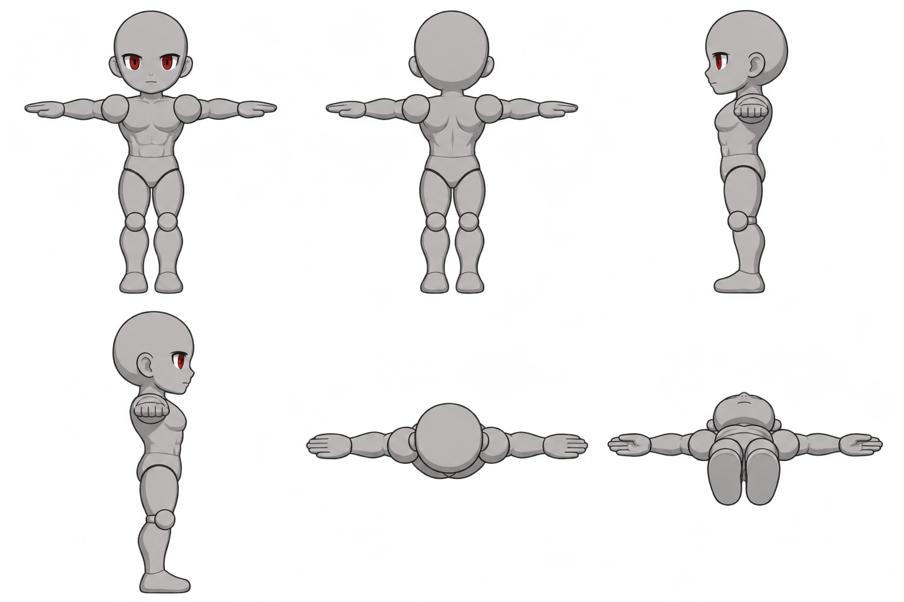
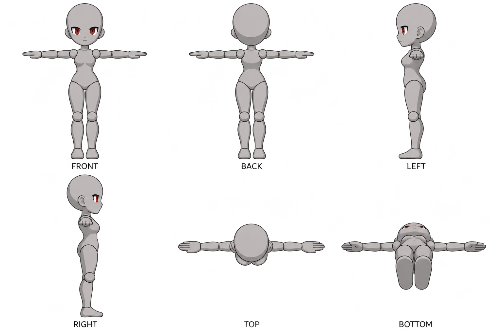
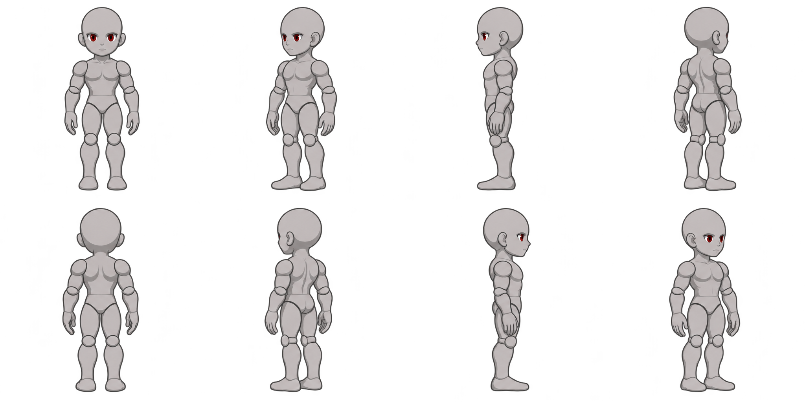
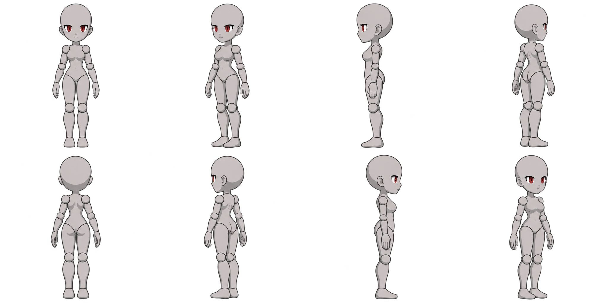
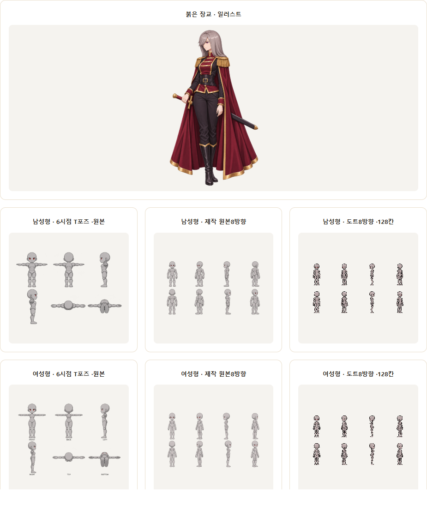

## 작업 결과

남녀6시점T포즈·원본8방향 수정 시안 적용.

## 변경 내용

### 적용 내용

ImageGen 비율 조정.5원본과3정확한 반전 조합. 기존 원본ZIP 보존. 도트8방향·장교 미변경. 가이드는 기존 규칙만 갱신하고 작업 내역은 AI기록에 저장.

## 검증

docs/build.mjs 성공. 실제 가이드 이미지 디코딩 및 캡처.3반전 정확성 확인. 도트8방향 HEAD 해시 동일. 프로젝트59bde6bd 커밋·main 푸시 성공. 별도 테스트 미실행.

## 남은 사항

외형 사용자 검토. 남녀 머리 비율·전체 키는 시각 근사이며 픽셀 단위 정합 미확인. 중앙 배포 미확인. 업데이트 원격 조회 실패, 알려진014 적용. SkillEvaluator·CLI-Anything 적용 대상 아님.

## 작업 시간

- 제안 시간: 5~7분
- 실제로 완료된 시간: 확인 가능한 실측 구간17:46:52~17:51:30 KST 약4분38초. 초기 확인 구간은 별도 측정되지 않음.
- XERJ: 미사용 — ImageGen·파일·로컬 브라우저 API 사용
