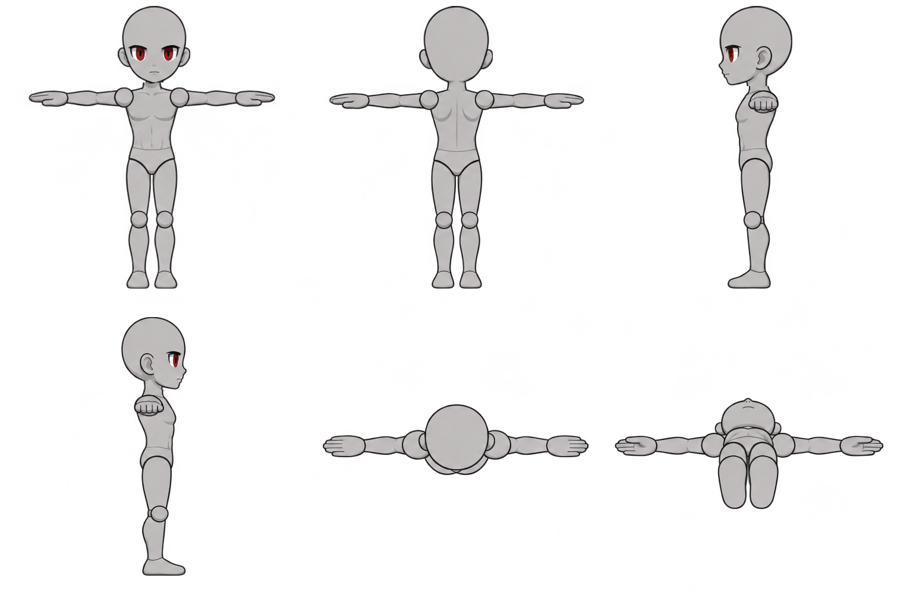
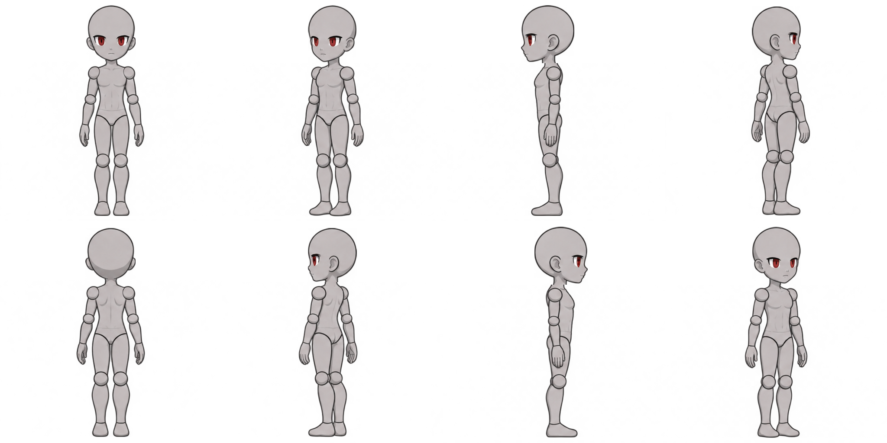
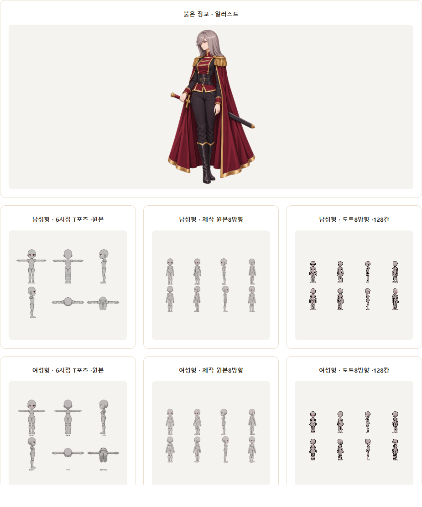

## 작업 결과

T포즈 정면 머리122×129px·키476px, 원본8방향 정면 머리114×130px·키487px. 여성형 동일 시점과 일치.

## 변경 내용

### 적용 내용

ImageGen으로 슬림한 남성형 재제작. 머리 영역과 나머지 몸체를 여성형 실측 치수에 Lanczos3로 기하 보정. 원본 보존. 색상 양자화·윤곽선 재작성 없음. 여성형·도트8방향·장교 유지. 가이드는 실측 기준만 갱신하고 작업 내역은 AI기록에 기록.

## 검증

수동 턱 경계ROI·alpha>=128 기준 실측. T포즈4직립 시점+5방향 원본의 머리 폭·높이·전체 키 차이0px. 반대3방향 정확한 반전. 여성형 원본·남녀 도트8방향 HEAD 해시 동일. docs/build.mjs 성공. 실제 가이드 이미지 디코딩·캡처 확인. 테스트 미실행.

## 남은 사항

외형 승인 대기. 상면/하면은 투영 시안이며 머리 실측 일치 검증 범위에서 제외. 중앙 배포 미확인. 지침 원격 최신013 확인, 사용자 제공014우선. SkillEvaluator·CLI-Anything 적용 대상 아님.

## 작업 시간

- 제안 시간: 5~8분
- 실제로 완료된 시간: 시작2026-11-20 17:54:06 KST. 제작 및 확인 2026-11-20 17:59:54 KST까지 348초. 게시·푸시 시간 별도.
- XERJ: 미사용 — ImageGen·PNG 실측·Sharp 기하 보정·로컬 브라우저 API 사용
