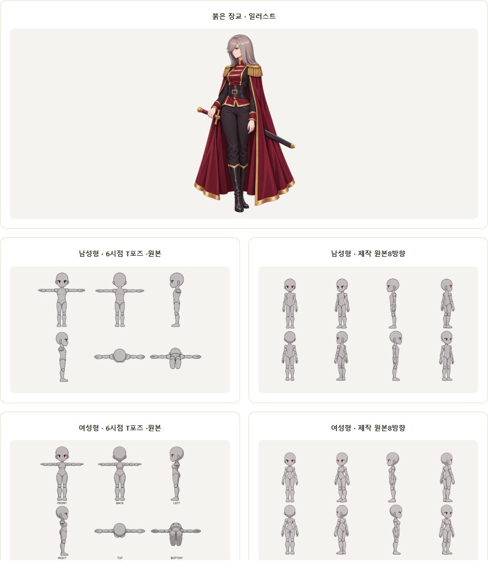

## 작업 결과

남녀 T포즈와 제작 원본 8방향을 두 열로 표시합니다.

## 변경 내용

### 적용 내용

마네퀸 사전 제작 도트 시트 4개와 참조를 제거했습니다.

## 검증

문서 빌드 성공. 브라우저에서 예제 5장 디코딩 및 실제 화면 캡처.

## 남은 사항

PixelLab 생성 미실행. 중앙 배포 미확인.

## 작업 시간

- 제안 시간: 3~5분
- 실제로 완료된 시간: 18:07:11 KST부터 18:09:13 KST까지 작업. 게시 시간 별도.
- XERJ: 미사용 — 로컬 파일 및 브라우저 사용
