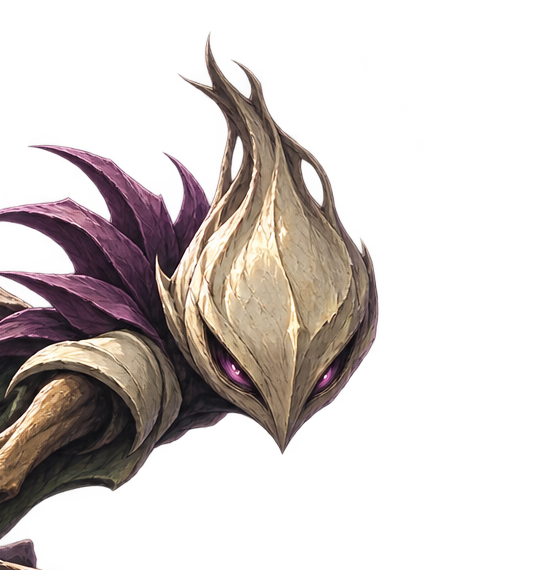

## 작업 결과

이미지 291119522바이트에서 245508593바이트로 절감. 원본과 동일한 PNG 스캔라인·압축 외 청크 검증. 다음은 적용한 가시추적자 프로필입니다.

## 변경 내용

### 적용 내용

생성기와 문서 빌드의 새 아트 경로에 무손실 프로그램 연결. 6개 이전 백업의 정본 매핑·해시 보존, 69개 미사용 import 기록 삭제.

## 검증

2657개 변경 후보의 Git 버전과 PNG 데이터 및 색상 메타데이터 비교. 1224개 바이트 고정 파일 보존. 현재 정규화 목록 1181개 해시 일치. 문서 16페이지·이미지 1026개 빌드. 프로젝트 커밋 9c2c92a5.

## 남은 사항

원본·편집 중 파일·PixelLab 모션·바이트 고정 계약, APNG 및 서명된 PNG를 보존. 실제 게임 전체 플레이 미확인.

## 작업 시간

- 제안 시간: 5~10분
- 실제로 완료된 시간: 2026-11-20 17:58:26 KST 시작. 18:14 KST 프로젝트 커밋 확인. SHA-256 고정 항목과 동시 변경 대조로 예상 초과.
- XERJ: 미사용 — Node zlib·SHA-256·Git 검증 사용
