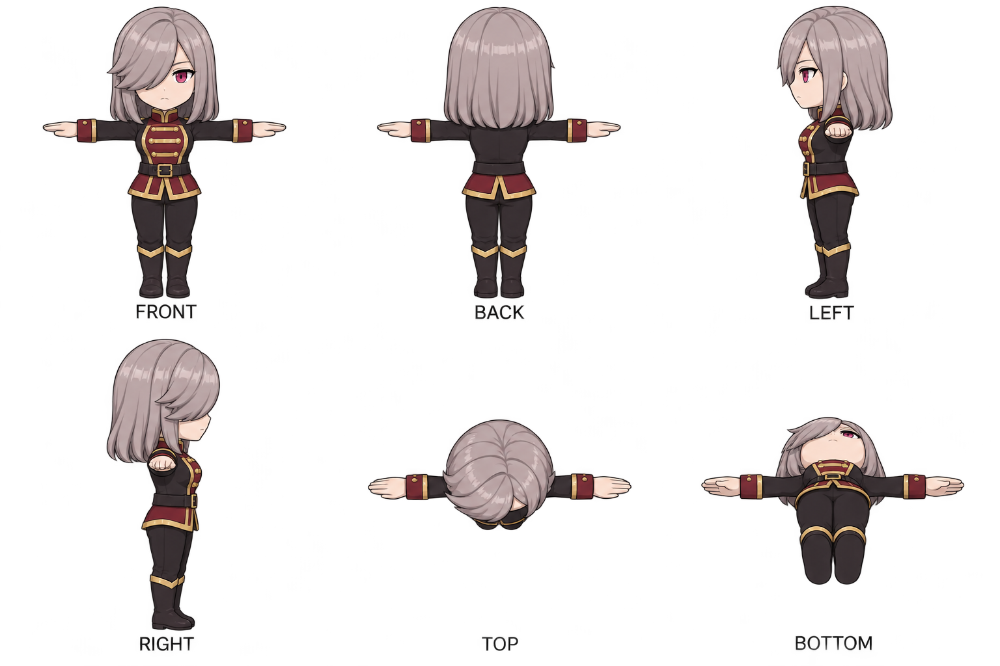
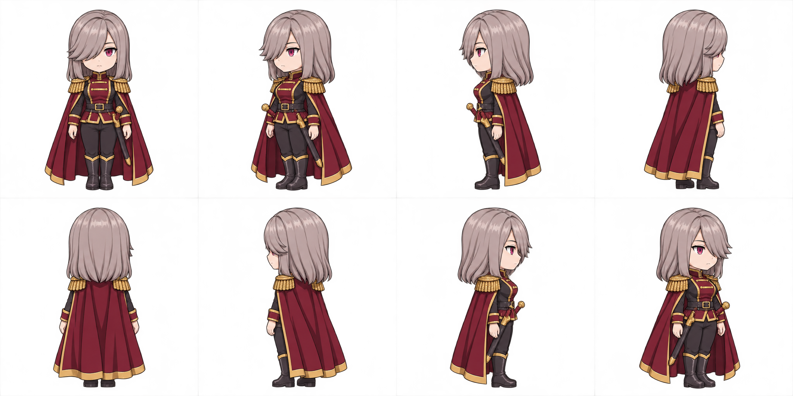

## 작업 결과

## 변경 내용

### 적용 내용

ImageGen으로 어깨 길이 생머리와 한쪽 눈을 덮는 앞머리를 살려 제작하고 캐릭터 아카이브에 연결했습니다.

## 검증

방향당 512×512, 전체 2048×1024. 원본 5장과 정확한 반전 3장. 문서 빌드와 아카이브 이미지 표시 확인.

## 남은 사항

반전 방향의 앞머리와 칼집 좌우도 바뀝니다. 외형 승인 및 중앙 배포 미확인.

## 작업 시간

- 제안 시간: 5~8분
- 실제로 완료된 시간: 18:09:47 KST 시작. 보고서 작성 시각 18:15:42 KST.
- XERJ: 미사용 — ImageGen과 로컬 브라우저 사용
