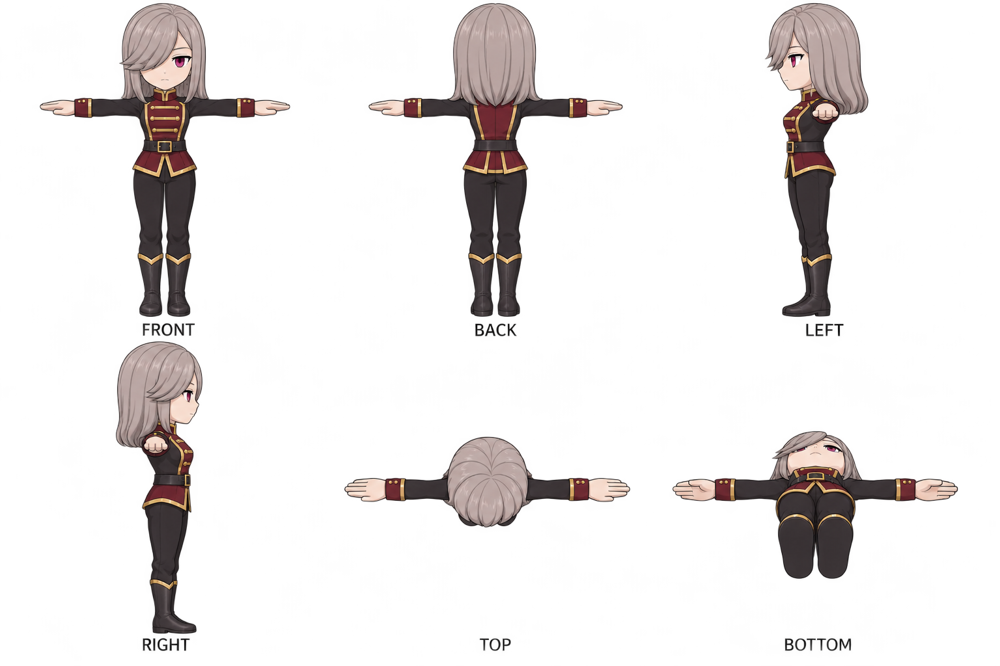
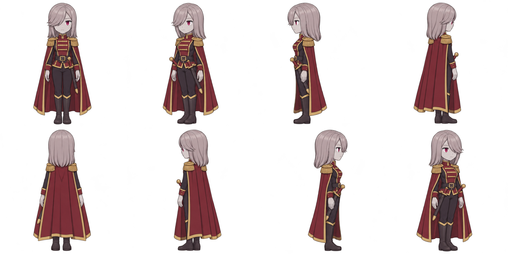
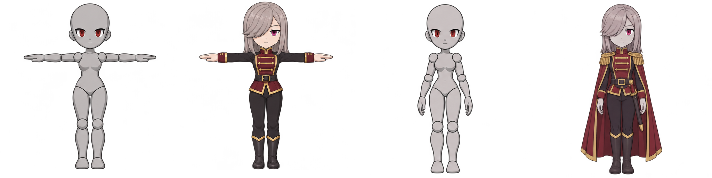

## 작업 결과

## 변경 내용

### 적용 내용

여성형 마네퀸 위에 붉은 장교 의상과 헤어를 입히는 방식으로 재생성했습니다.

## 검증

정면에서 정수리부터 턱까지 높이와 전체 키 비율 비교. T포즈 약27%와28%, 대기 약27%와25%. 문서 빌드 성공.

## 남은 사항

정면 육안 근사치. 옷에 가린 관절 및 나머지 시점의 정확한 정합은 미확인. 중앙 배포 미확인.

## 작업 시간

- 제안 시간: 5~8분
- 실제로 완료된 시간: 18:17:49 KST 시작, 18:20:43 KST 보고 작성.
- XERJ: 미사용 — ImageGen과 원본 PNG 비교
