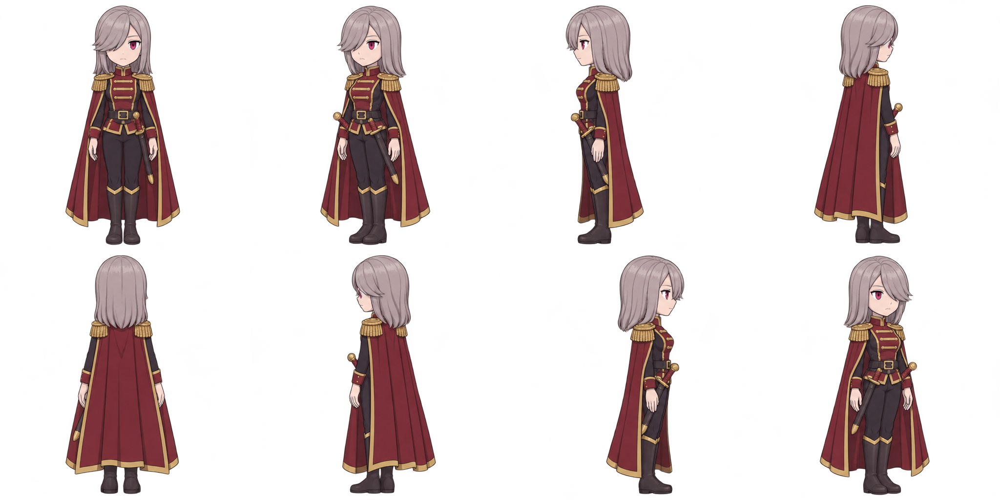

## 작업 결과

## 변경 내용

### 적용 내용

원본 RGB를 피부 영역에서 보정 후 8방향을 구성했습니다.

## 검증

원본 5방향의 모든 알파값이 기존과 동일하고 8방향 PNG를 열어 확인했습니다.

## 남은 사항

중앙 배포 미확인.

## 작업 시간

- 제안 시간: 2~4분
- 실제로 완료된 시간: 18:23:06 KST 시작, 18:25:10 KST 보고 작성.
- XERJ: 미사용 — ImageGen 및 로컬 PNG 확인
