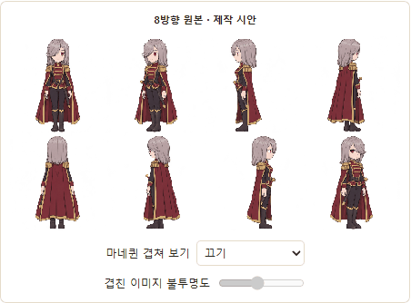
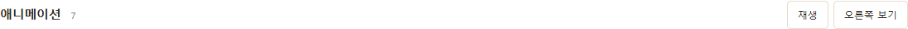

## 작업 결과

## 변경 내용

### 적용 내용

방향 시트에 남성형·여성형·둘 다 선택과 불투명도 조절을 추가했습니다. 선택한 캐릭터의 애니메이션 영역으로 공용 버튼을 이동했습니다.

## 검증

문서 빌드 성공. 브라우저에서 선택 4종, 마네퀸 이미지 디코딩, 불투명도, 버튼 상태, 캐릭터 변경 시 버튼 이동 확인. GIF 4프레임 확인.

## 남은 사항

중앙 배포 미확인.

## 작업 시간

- 제안 시간: 4~6분
- 실제로 완료된 시간: 18:36:58 KST 시작, 18:39:27 KST 보고 작성.
- XERJ: 미사용 — 로컬 파일 및 실제 브라우저 캡처
