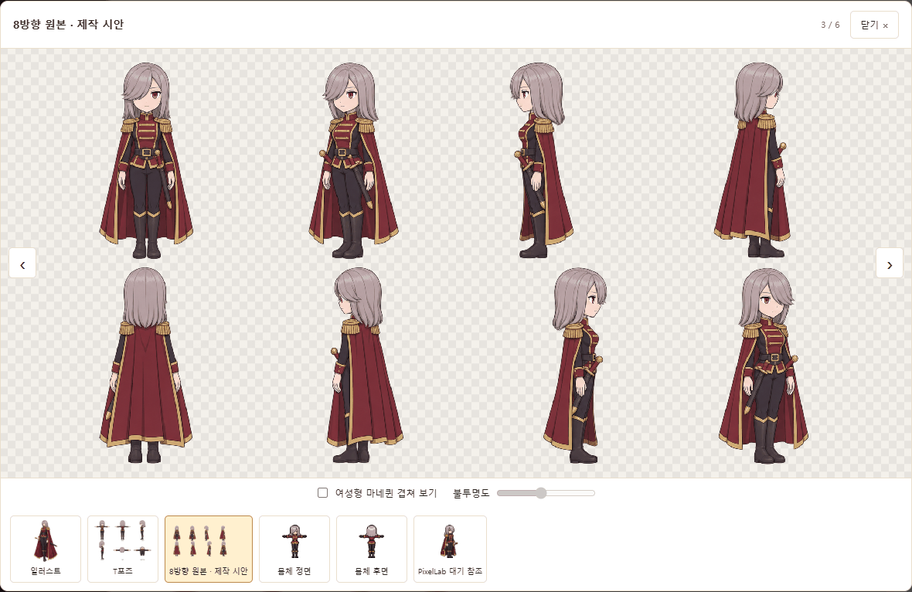

## 작업 결과

## 변경 내용

### 적용 내용

classes.gender를 추가했습니다. 장교 여성형, 기사 남성형, 미정 값은 비교 숨김. 데이터 테이블 성별 열과 확대 창을 갱신했습니다.

## 검증

빌드 성공. 브라우저에서 장교·기사의 마네퀸 선택, 켜기와 불투명도, 다른 이미지로 이동 시 숨김 확인. 실제 GIF 2프레임 확인.

## 남은 사항

중앙 배포 미확인.

## 작업 시간

- 제안 시간: 4~6분
- 실제로 완료된 시간: 18:40:52 KST 시작, 18:43:48 KST 보고 작성.
- XERJ: 미사용 — 로컬 문서 및 브라우저 캡처
