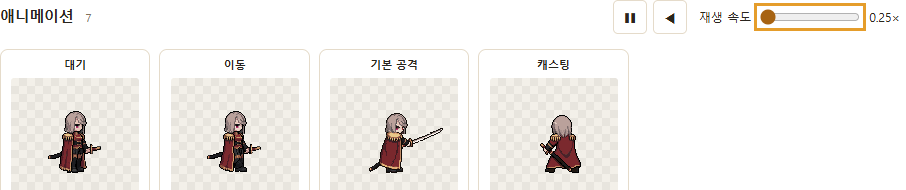

## 작업 결과

## 변경 내용

### 적용 내용

0.25배 단위 재생 슬라이더, 현재 배속 표시, 접근 가능한 버튼 아이콘.

## 검증

문서 빌드 성공. 브라우저에서 양쪽 배속값, 움직이는 프레임, 일시정지, 방향 아이콘 전환 확인.

## 남은 사항

중앙 배포 미확인.

## 작업 시간

- 제안 시간: 3~5분
- 실제로 완료된 시간: 18:44:20 KST 시작, 18:45:45 KST 보고 작성.
- XERJ: 미사용 — 로컬 브라우저 캡처
