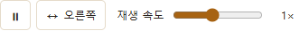

## 작업 결과

## 변경 내용

### 적용 내용

재생·일시정지는 ▶와 ⏸, 방향은 ↔와 왼쪽·오른쪽을 표시합니다.

## 검증

문서 빌드와 실제 브라우저에서 두 상태의 버튼 표시 확인. GIF 두 프레임 확인.

## 남은 사항

중앙 배포 미확인.

## 작업 시간

- 제안 시간: 2~3분
- 실제로 완료된 시간: 18:48:47 KST 시작, 18:50:08 KST 보고 작성.
- XERJ: 미사용 — 로컬 브라우저 화면 확인
