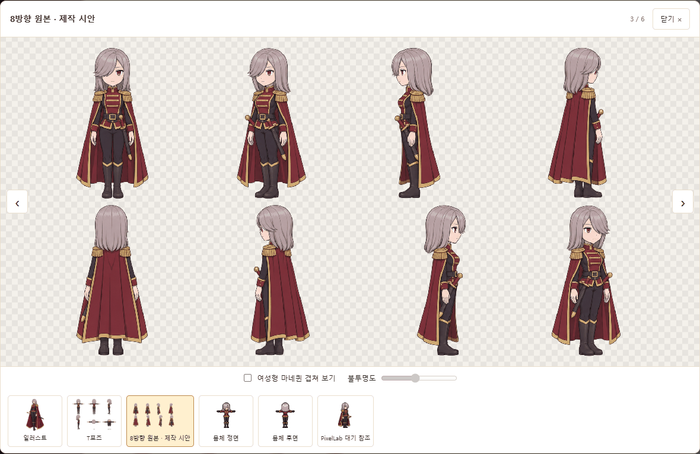

## 작업 결과

## 변경 내용

### 적용 내용

투명 시트 하단의 실루엣으로 발 위치를 추정하고 겹치는 마네퀸을 방향별로 이동합니다. 가이드에 발 기준을 반영했습니다.

## 검증

문서 빌드 및 브라우저에서 붉은 장교와 잿빛 기사의 8개 바닥선 일치 확인.

## 남은 사항

발을 가리는 시안의 발 위치는 하단 실루엣을 사용합니다. 아트 원본 개별 재배치는 미진행. 중앙 배포 미확인.

## 작업 시간

- 제안 시간: 3~5분
- 실제로 완료된 시간: 18:50:40 KST 시작, 18:52:43 KST 보고 작성.
- XERJ: 미사용 — 실제 브라우저 캡처
