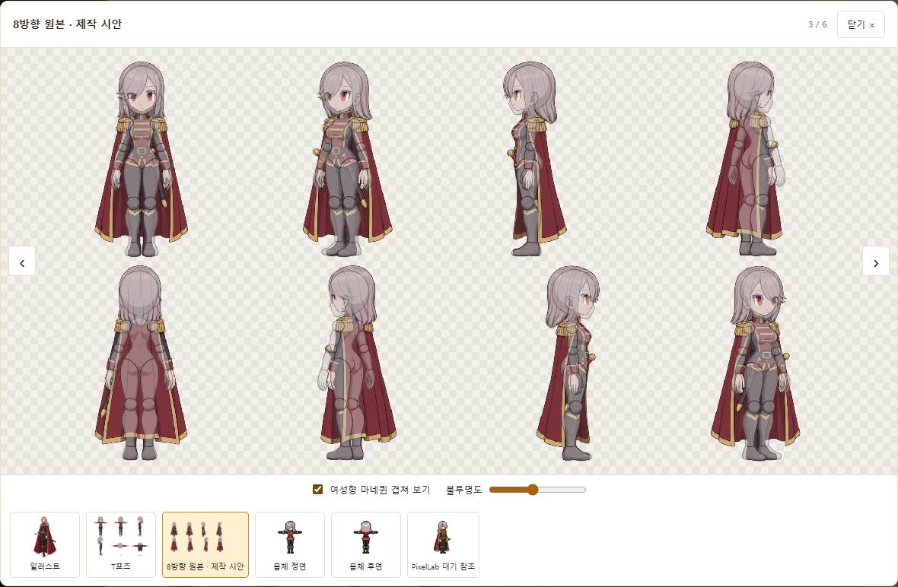
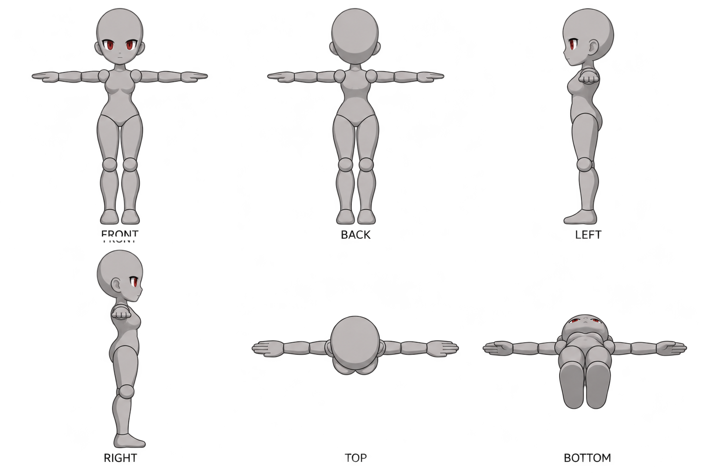
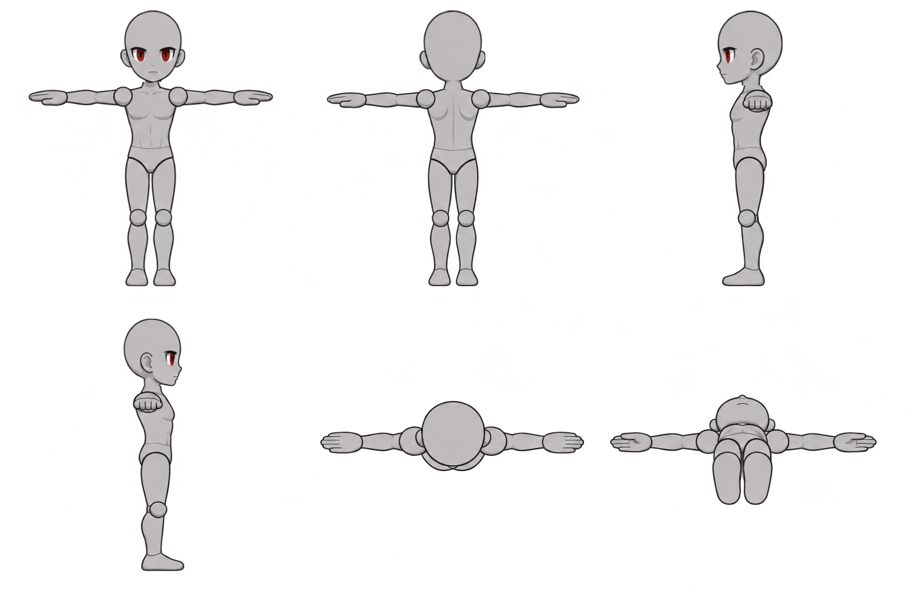
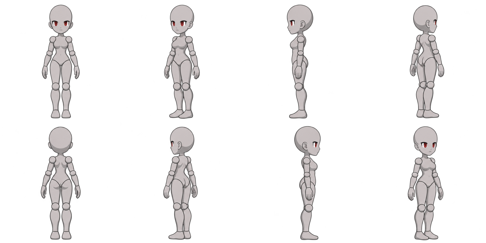
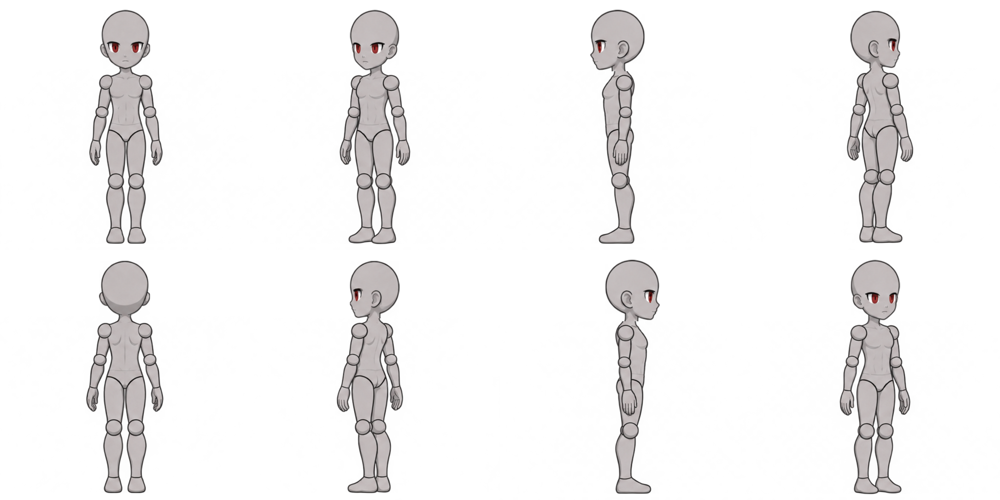

## 작업 결과

## 변경 내용

### 적용 내용

정면 머리 높이 두 마네퀸 모두 129→121px. 8방향과 T포즈 4직립 시점 보정.

## 검증

브라우저에서 동일 장교에 남녀 각각 50% 합성. 실측 JSON 작성, 문서 빌드 확인.

## 남은 사항

장교 앞머리 아래의 윤곽과 T포즈 상면·하면은 정합 확인 범위 제외. 중앙 배포 미확인.

## 작업 시간

- 제안 시간: 5~8분
- 실제로 완료된 시간: 19:09:14 KST 시작, 19:13:34 KST 보고 작성.
- XERJ: 미사용 — ImageGen 시안, 기존 PNG 머리 부위 편집 및 브라우저 확인
