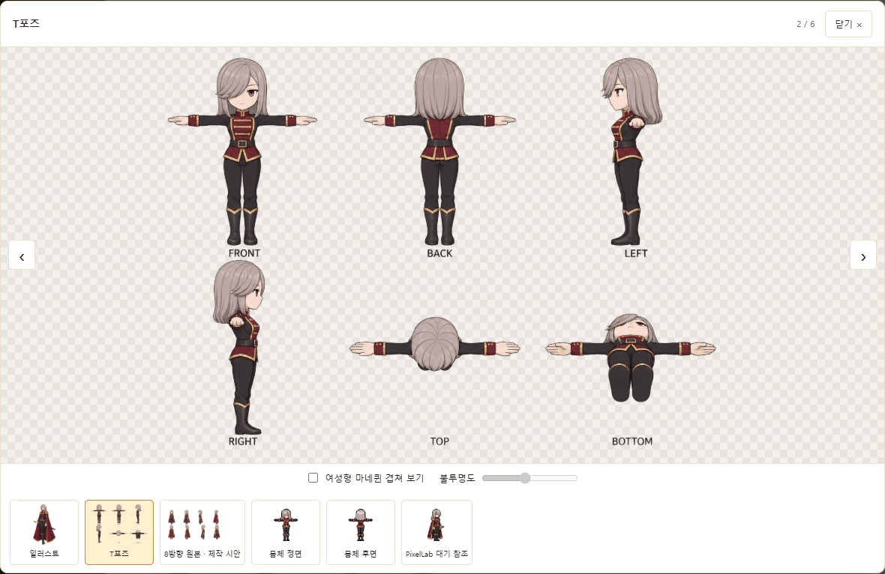

## 작업 결과

## 변경 내용

### 적용 내용

6시점 T포즈에 같은 3×2 크기로 마네퀸을 겹칩니다.

## 검증

문서 빌드, T포즈 비교와 불투명도 60%, 8방향 전환 확인. 실제 GIF 2프레임 확인.

## 남은 사항

Affinity MCP 연결이 ECONNREFUSED로 레이어 원본과 무기·장식 별도 파일 제작 미진행. 중앙 배포 미확인.

## 작업 시간

- 제안 시간: 초기 확인 2~3분
- 실제로 완료된 시간: 19:20:50 KST부터 19:23:00 KST까지 부분 결과 보고.
- XERJ: 미사용 — Affinity CLI 및 로컬 브라우저 사용
