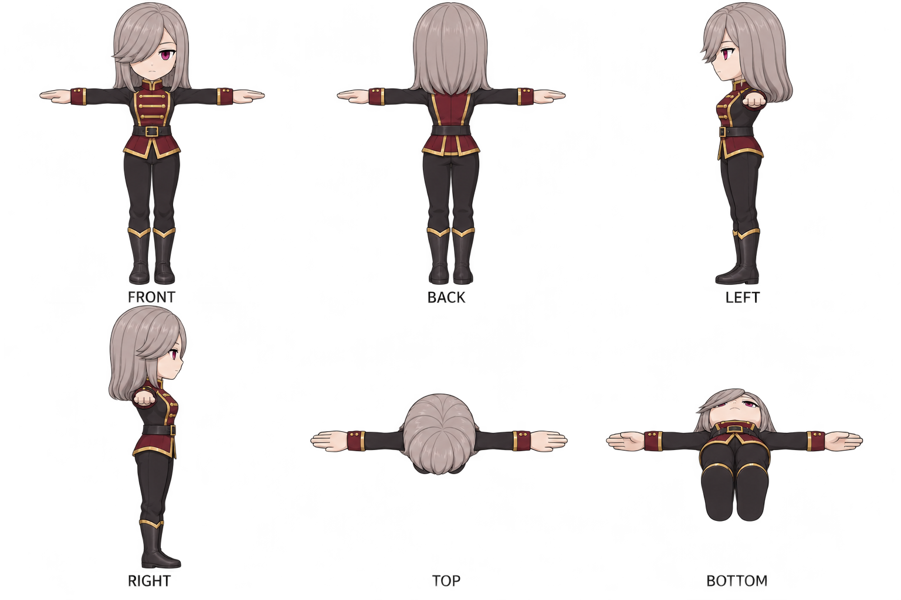
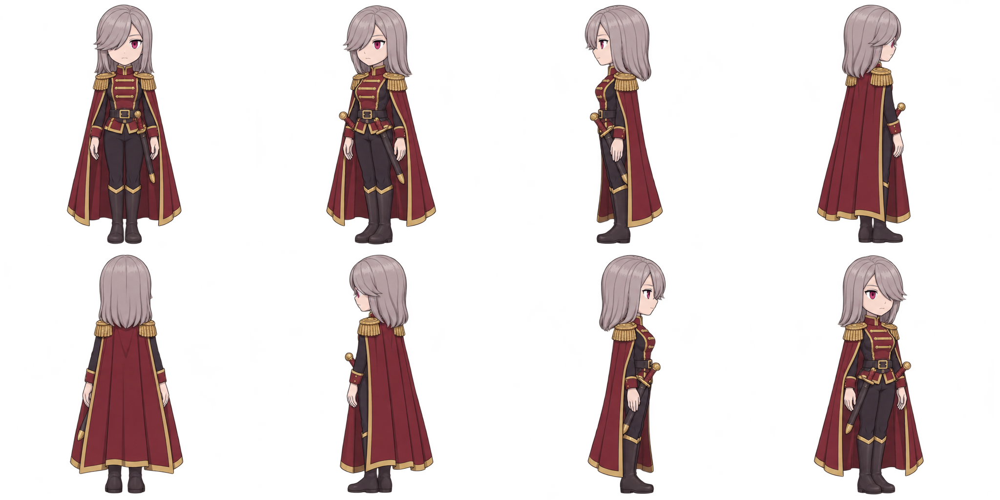
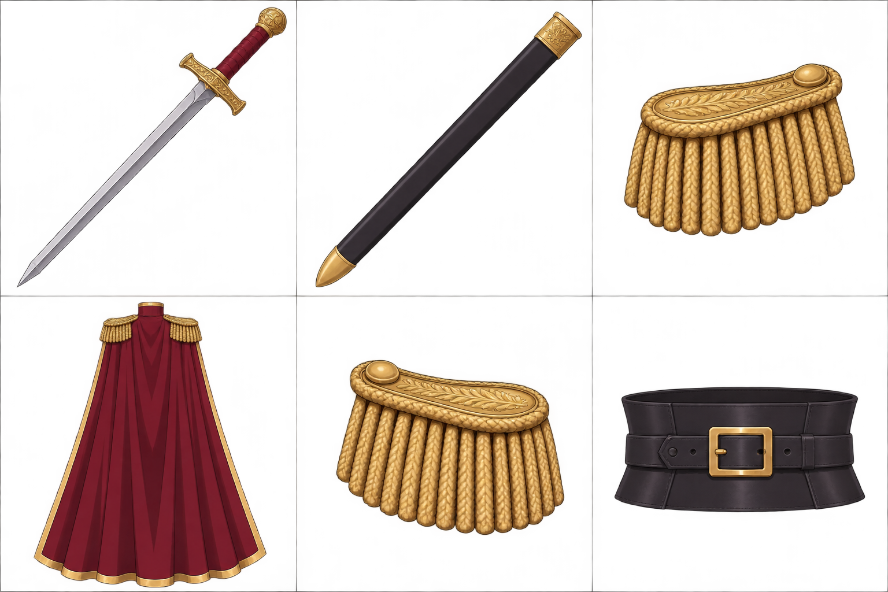
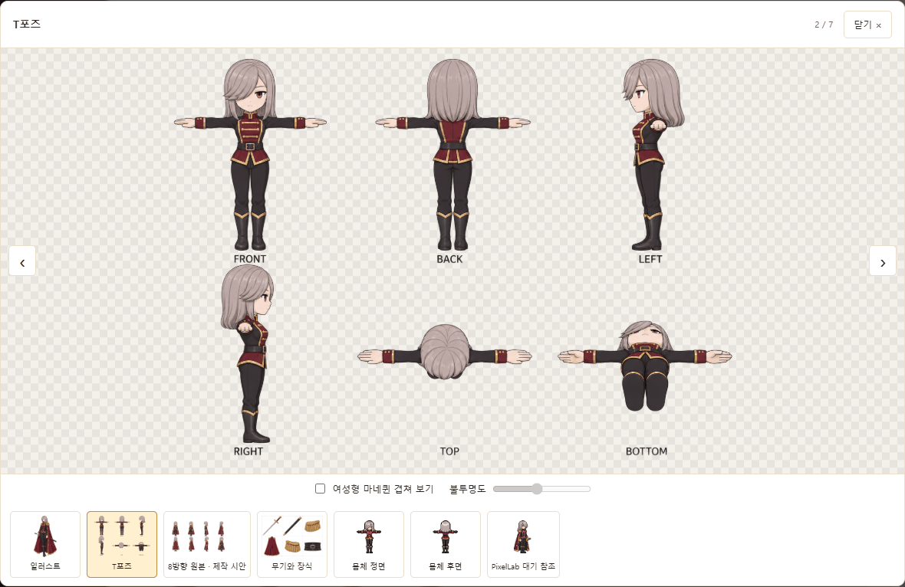

## 작업 결과

## 변경 내용

### 적용 내용

기존 시안의 보이는 파츠를 분리하고 방향별 발 위치를 맞췄습니다. 장비 시안을 새로 그려 6개 레이어로 넣었습니다.

## 검증

Affinity CLI에서 세 .af를 저장하고 다시 열어 각각 4, 5, 6개 레이어와 미저장 없음 및 기준 잠금 확인. 브라우저에서 T포즈 비교·8방향·장비 열기 확인.

## 남은 사항

기존 그림에서 가려진 부위의 재작화·리깅은 미진행. 장비 시안의 전용 컷아웃 정리 미확인. 중앙 배포 미확인.

## 작업 시간

- 제안 시간: 초기 확인 2~3분, 전체 제작 별도
- 실제로 완료된 시간: 19:20:50 KST 시작, 19:29:53 KST 보고 작성.
- XERJ: 미사용 — Affinity CLI, ImageGen 참고 시안, 로컬 브라우저 캡처
