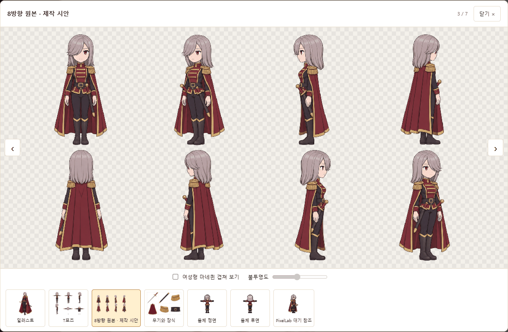

## 작업 결과

## 변경 내용

### 적용 내용

T포즈는 이미지 합성만 사용합니다. 현행 장교·기사 8방향은 이미지 해시에 결합한 발 정렬값으로 합성합니다.

## 검증

로컬 파일에서 SecurityError 재현. 수정 후 로컬 파일·HTTP에서 붉은 장교 T포즈 및 장교·기사 8방향 비교와 불투명도 검증. 빌드 및 GIF 확인.

## 남은 사항

정렬값이 없는 신규 시트의 로컬 파일 비교는 기본 위치에 표시됩니다. 중앙 배포 미확인.

## 작업 시간

- 제안 시간: 2~4분
- 실제로 완료된 시간: 19:58:06 KST부터 20:01:15 KST까지 작업.
- XERJ: 미사용 — 실제 브라우저 재현과 GIF 캡처
