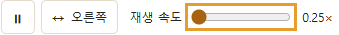

## 작업 결과

## 변경 내용

### 적용 내용

우측 배율에 고정폭 5ch를 확보하고 줄바꿈 없이 우측 정렬했습니다.

## 검증

실제 로컬 아카이브를 Chromium에 렌더링했습니다. 0.25×~2× 전 구간에서 버튼과 슬라이더의 좌표와 크기가 동일했습니다. 캡처 GIF 12프레임을 확인했습니다.

## 남은 사항

중앙 배포 미확인. 업데이트 원격 최신 미확인, 로컬 2026-11-20-014 적용.

## 작업 시간

- 제안 시간: 3~5분
- 실제로 완료된 시간: 20:07:03 KST 시작, 20:08:55 KST 결과 기록, 112초.
- XERJ: 미사용 — 로컬 Chromium 렌더와 프레임 캡처
