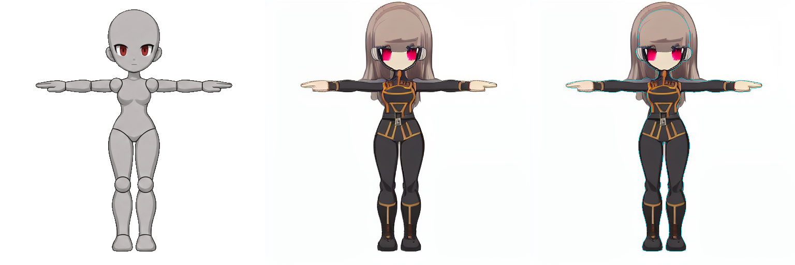
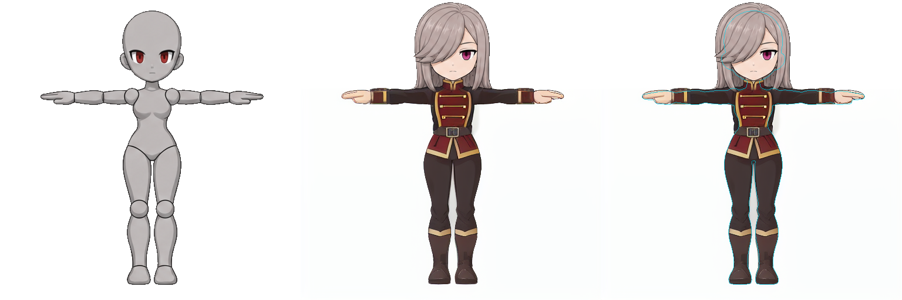

## 작업 결과

## 변경 내용

### 적용 내용

여성형 기준 외곽선을 추출해 SD1.5 Canny에 적용했습니다. 몸체 한정 비교에서는 기존 장교 머리를 합성했습니다.

## 검증

GTX970 Vulkan 실제 생성 54.78초 및 31.98초, 512×512 PNG와 외곽선 대조 확인. 최초 diffusers 체크포인트의 텐서 형식 오류는 호환 체크포인트로 복구.

## 남은 사항

전체 윤곽 적용에서는 얼굴과 제복이 변형됐습니다. 몸체 한정 합성도 목·어깨 정합 불일치가 있어 제작 정본에는 적용하지 않았습니다. 중앙 배포 미확인.

## 작업 시간

- 제안 시간: 환경 확인 1~2분, 모델 다운로드와 생성 별도
- 실제로 완료된 시간: 20:13:31 KST 시작, 20:21:07 KST 보고 작성.
- XERJ: 미사용 — 로컬 Vulkan CLI 및 실제 결과 PNG 사용
