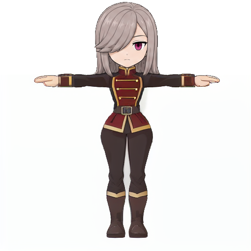
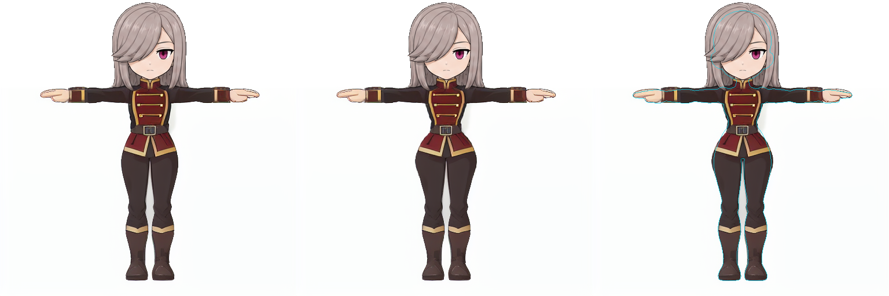

## 작업 결과

## 변경 내용

### 적용 내용

정면 시안에서 가슴·허리·골반 구간만 수평 변형했습니다.

## 검증

가슴 높이 y189 기준 폭 73→65px, 허리 y212 기준 65→51px, 골반 y279 기준 99→107px. 수정 창 밖 원본과 픽셀 동일. PNG 저장 및 시각 비교.

## 남은 사항

정면 수정 시안 검토 대기. 중앙 배포 미확인.

## 작업 시간

- 제안 시간: 3~5분
- 실제로 완료된 시간: 20:22:31 KST 시작, 20:24:07 KST 보고 작성.
- XERJ: 미사용 — ImageGen 확인 및 로컬 PNG 좌표 보정
