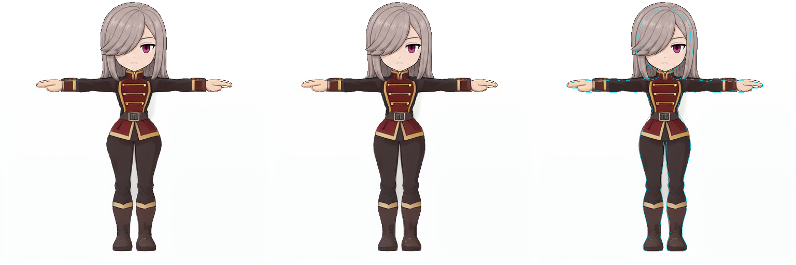
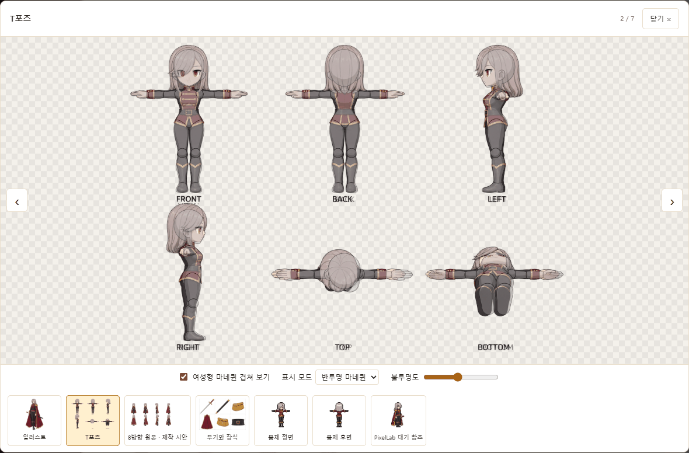

## 작업 결과

## 변경 내용

### 적용 내용

정면 골반 폭 107→101px. 아카이브의 기존 반투명 마네퀸과 윤곽선 모드를 전환할 수 있게 했습니다.

## 검증

문서 빌드, 로컬 HTML 및 HTTP에서 T포즈·8방향 모드 전환과 불투명도 확인. GIF 4프레임 검증.

## 남은 사항

골반 수정본은 별도 정면 시안입니다. 중앙 배포 미확인.

## 작업 시간

- 제안 시간: 4~6분
- 실제로 완료된 시간: 20:25:49 KST 시작, 20:28:32 KST 보고 작성.
- XERJ: 미사용 — 실측 PNG 및 실제 브라우저 캡처
