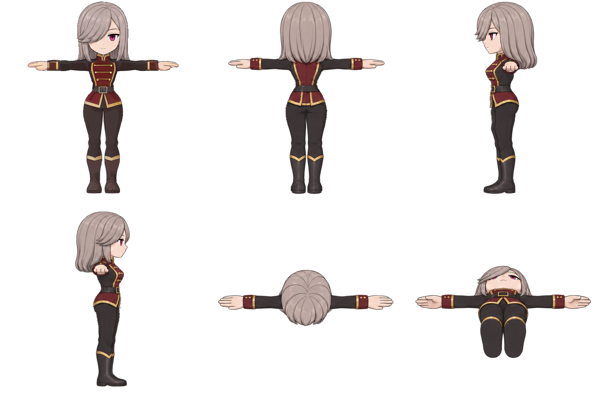
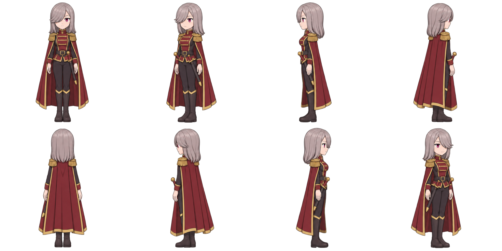
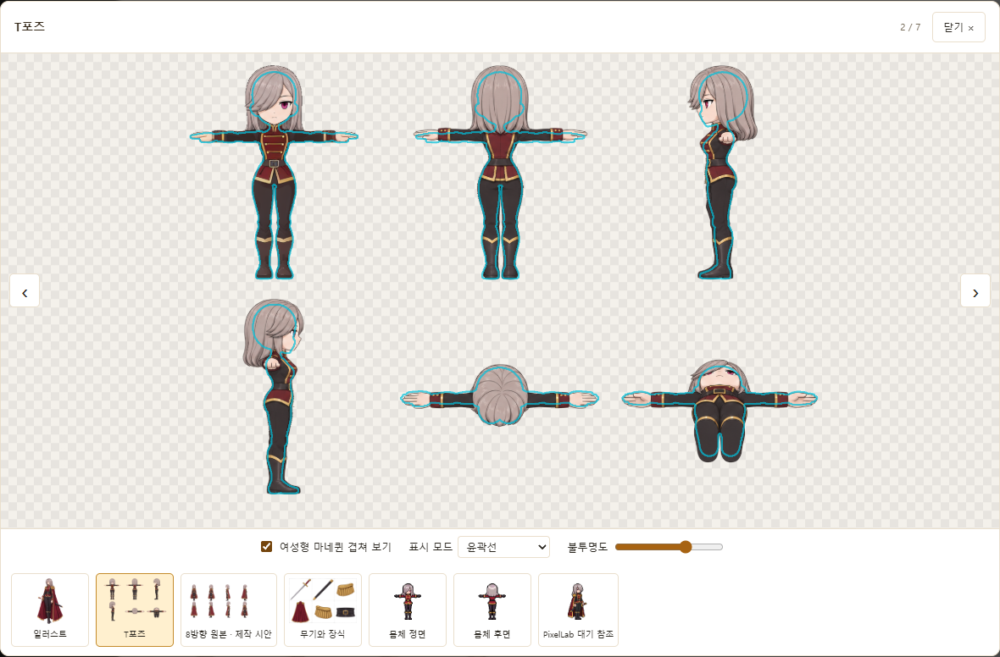
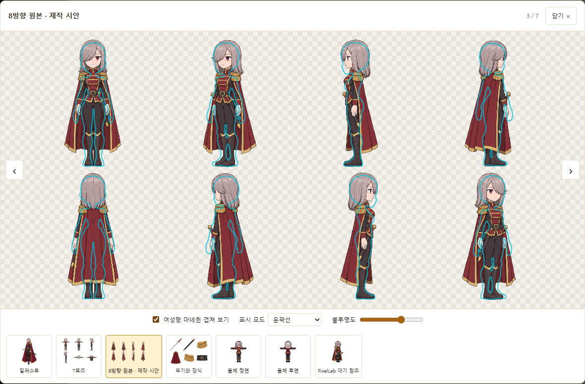
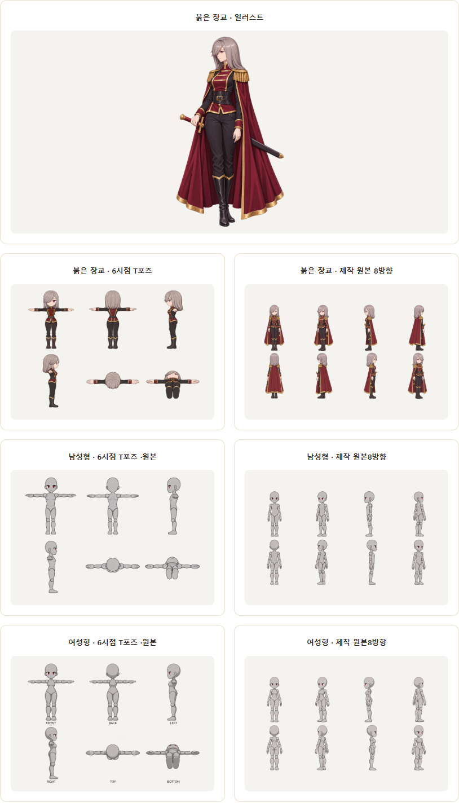

## 작업 결과

## 변경 내용

### 적용 내용

정면 보정본을 사용하고 후면·좌우 T포즈를 마네퀸 가슴·허리·골반·엉덩이 윤곽에 맞춰 조정. 8방향 5원본+3반전. 상면·하면 투영 중심 정렬. 제작 가이드 기준과 예제 갱신.

## 검증

직립 T포즈 발 좌표 일치, 8방향 바닥선 전부 일치, 반전 한 방향 가로 1px 차이. 상·하면 중심 일치. 문서 빌드·아카이브 윤곽선·가이드 예제 7장 실제 확인.

## 남은 사항

의복 두께와 가려진 부위는 신체 윤곽과 다릅니다. Affinity 연결 거부로 신규 네이티브 원본은 작성하지 않았습니다. 중앙 배포 미확인.

## 작업 시간

- 제안 시간: 7~10분
- 실제로 완료된 시간: 20:30:54 KST 시작, 20:38:51 KST 보고 작성.
- XERJ: 미사용 — ImageGen 및 브라우저·PNG 실측
