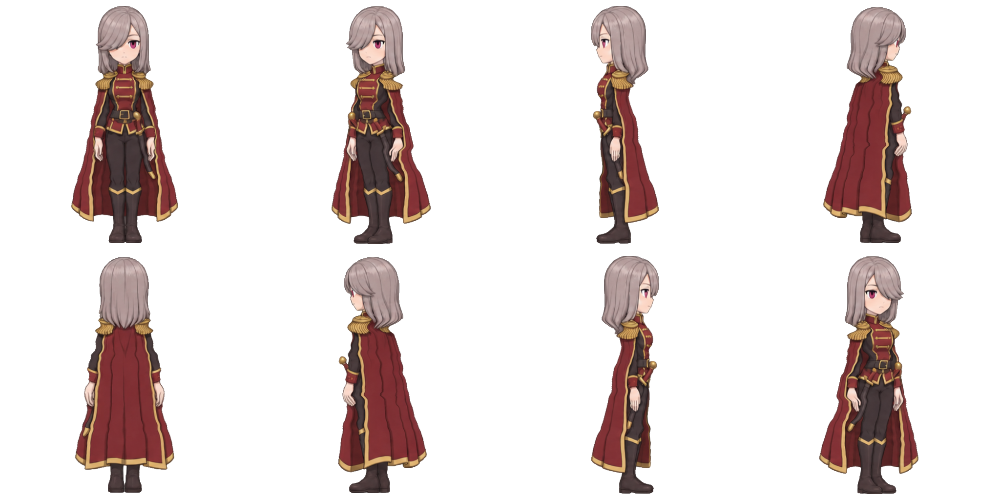
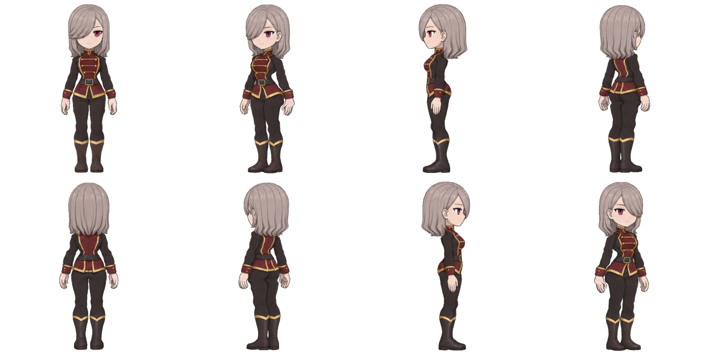
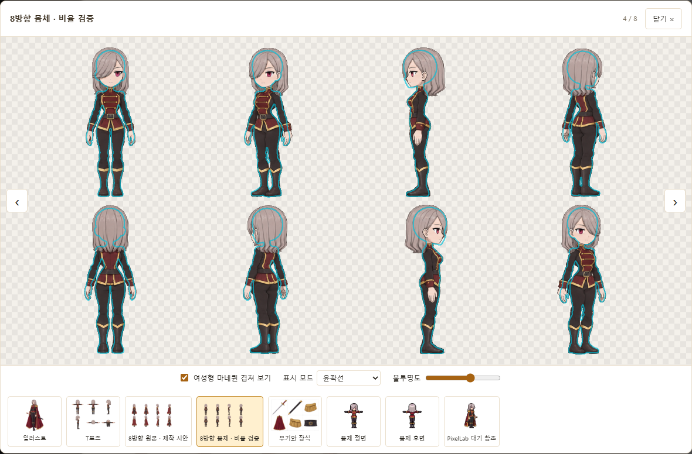

## 작업 결과

## 변경 내용

### 적용 내용

장교 8방향 시트 교체, 장비 없는 몸체 비교 추가. T포즈 보존. 프로젝트 main a58ada69 푸시 확인.

## 검증

방향당 512×512 및 3방향 픽셀 반전 확인. 발바닥 높이 차이 0px. 몸체 마스크 윤곽 겹침 84~91%에서 91~94%로 개선. 웹 빌드와 로컬 윤곽 전환 확인.

## 남은 사항

의상과 실루엣에는 일부 차이가 남고 외형 승인 대기. 중앙 배포 미확인.

## 작업 시간

- 제안 시간: 4~7분
- 실제로 완료된 시간: 20:43:15 KST 시작, 20:48:40 KST 제작 및 검증 완료. 5분 25초. 커밋과 게시 별도.
- XERJ: 미사용 — ImageGen, PNG 실측, 로컬 브라우저
