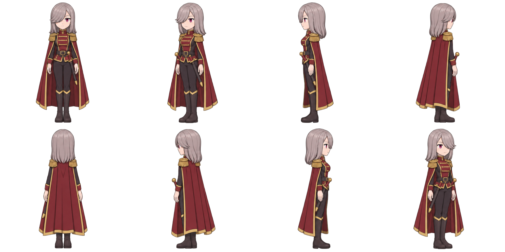

## 작업 결과

## 변경 내용

### 적용 내용

직전 8방향과 아카이브 연결 복원, 커밋 f270cf9a 푸시.

## 검증

직전 커밋의 장교 원본 및 아카이브 소스와 일치. 웹 빌드 성공.

## 남은 사항

마네킹 체형 일치는 미완료. 중앙 배포 미확인.

## 작업 시간

- 제안 시간: 2~3분
- 실제로 완료된 시간: 20:53:09 KST 확인 시작, 20:53:31 KST 복원 및 프로젝트 푸시. 22초, 보고 별도.
- XERJ: 미사용 — Git, 문서 빌드, 복원 PNG
