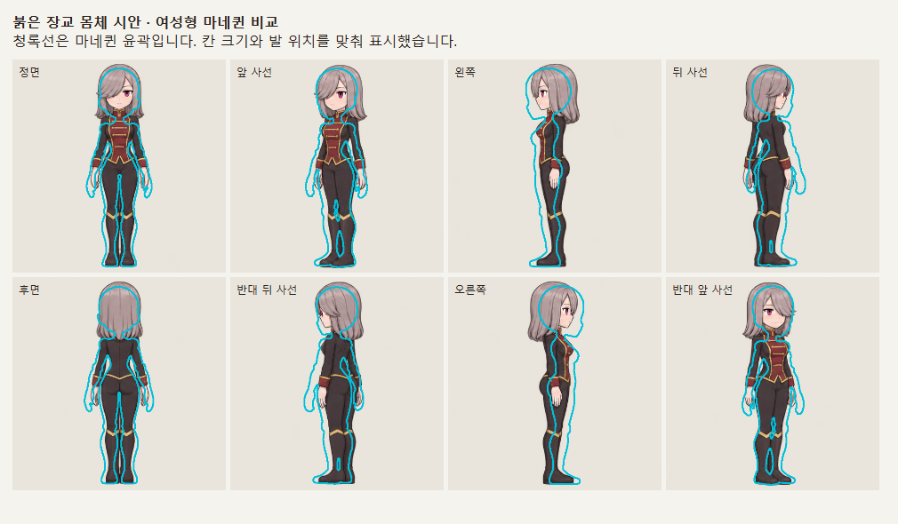

## 작업 결과

## 변경 내용

### 적용 내용

ImageGen 몸체 재시안 검토. 프로젝트에 채택하지 않음.

## 검증

칸 크기와 발 위치를 맞춘 브라우저 비교. 앞·뒤 사선 및 측면 실루엣 오차 확인.

## 남은 사항

Affinity 연결 거부. 기준선을 잠근 뒤 몸체 트레이싱 및 장비 합성 필요. 중앙 배포 미확인.

## 작업 시간

- 제안 시간: 5~8분
- 실제로 완료된 시간: 20:57:30 KST 시작. 20:59:53 KST까지 시안 및 비교.
- XERJ: 미사용 — ImageGen과 실제 PNG 브라우저 대조, Affinity CLI 연결 진단
