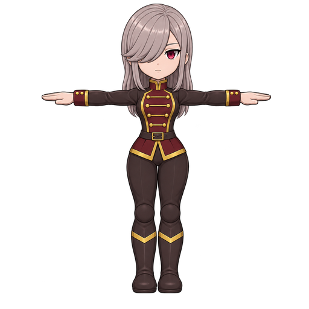
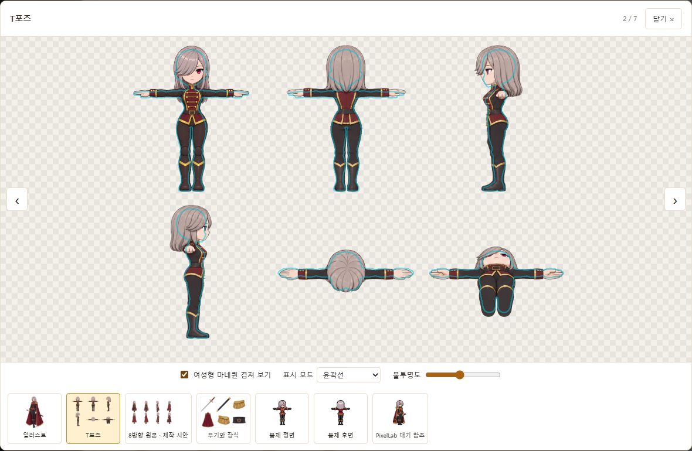
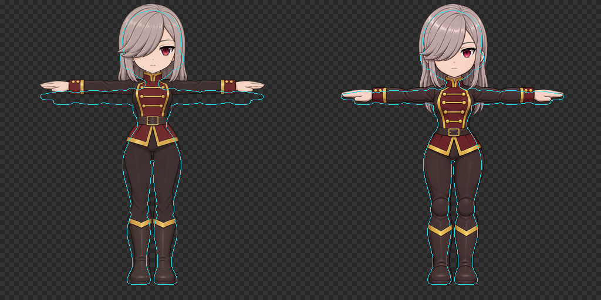

## 작업 결과

## 변경 내용

### 적용 내용

정면 한 칸 교체. 아카이브 갱신. 커밋 ecc5a60e.

## 검증

팔 중심 오차 17~19px에서 4~5px. 8개 몸통 높이 표본 폭 오차 최대 13px에서 5px. 나머지 다섯 칸 픽셀 동일. 실제 모달 윤곽 표시 확인.

## 남은 사항

중앙 배포 미확인.

## 작업 시간

- 제안 시간: 3~5분
- 실제로 완료된 시간: 21:07:37 KST 확인 시작, 21:09:24 KST 보고 작성.
- XERJ: 미사용 — 실제 PNG와 문서 빌드
