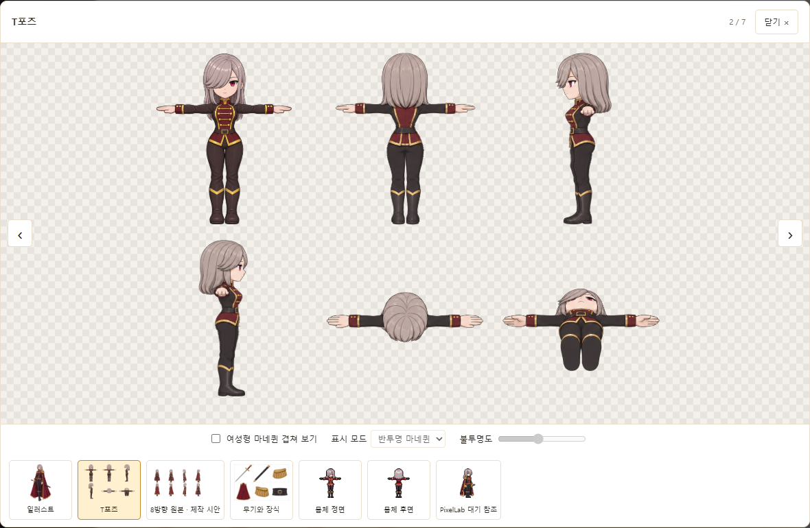

## 작업 결과

## 변경 내용

### 적용 내용

정면 무릎 부위 색상만 교체. 아카이브 갱신. 커밋 2300399b.

## 검증

정면 전체 알파, 무릎 높이 범위 외 픽셀 및 나머지 다섯 칸 동일. 웹 빌드 및 모달 표시 확인.

## 남은 사항

중앙 배포 미확인.

## 작업 시간

- 제안 시간: 2~4분
- 실제로 완료된 시간: 21:09:34 KST 시작, 21:10:51 KST 푸시 완료까지 약 1분 17초, 21:11:06 KST 보고 작성.
- XERJ: 미사용 — 실제 PNG와 문서 빌드
