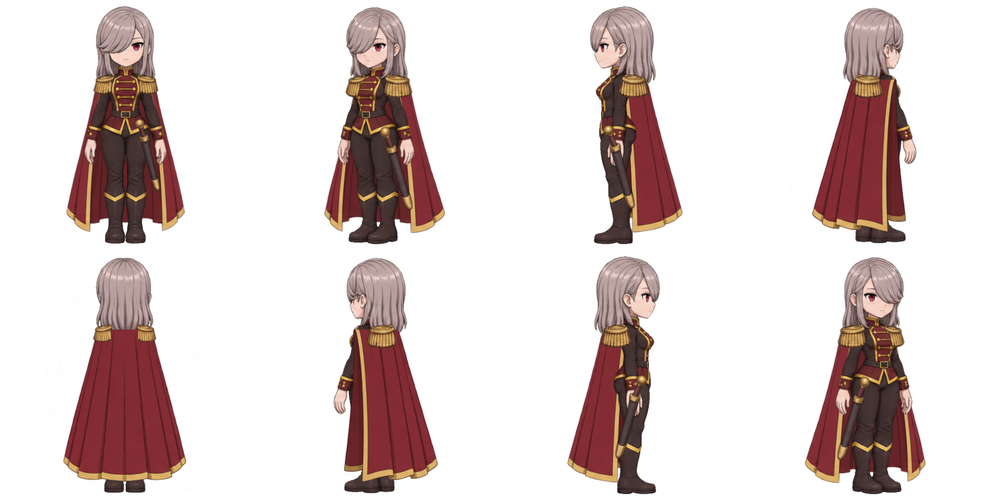
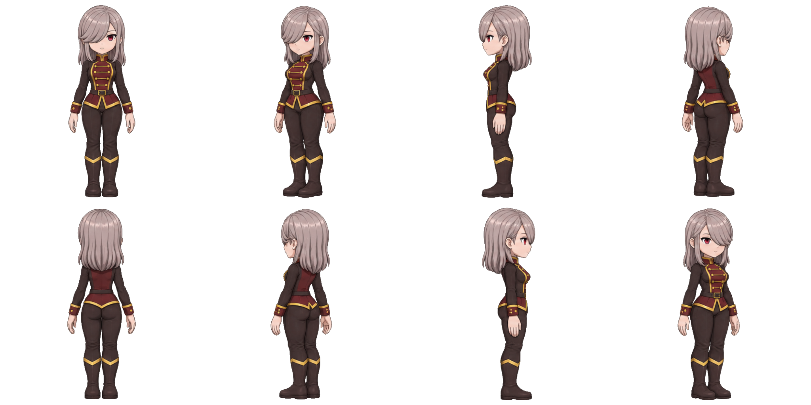
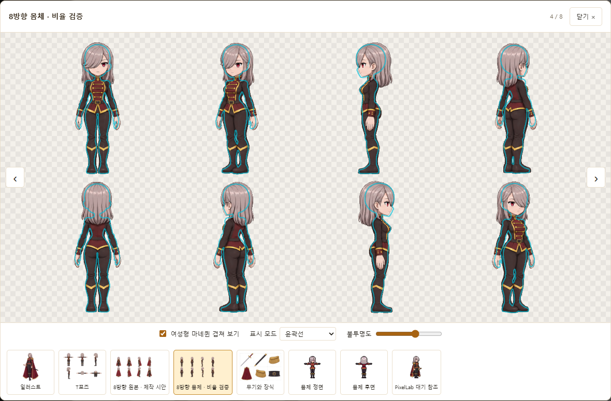

## 작업 결과

## 변경 내용

### 적용 내용

몸체·망토·장비 PNG와 합성본, 실제 아카이브 비교, 가이드 예제 연결. 프로젝트 커밋 cff0b1e8.

## 검증

방향당 512×512 및 3방향 픽셀 반전 확인. 발바닥 높이 차이 0px. 동일 비율 배치 후 몸체 마스크 겹침 84~89%. 웹 빌드와 로컬 윤곽 전환 확인.

## 남은 사항

측면과 사선 체형에 차이가 남음. Affinity 연결 거부로 네이티브 파일 작성 미완료. 중앙 배포 미확인.

## 작업 시간

- 제안 시간: 5~8분
- 실제로 완료된 시간: 21:12:10 KST 확인 시작. 21:14:35 KST 보고 작성.
- XERJ: 미사용 — ImageGen, PNG 실측, 로컬 브라우저
