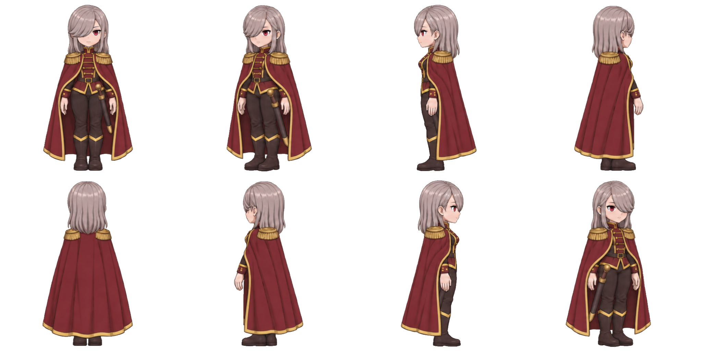
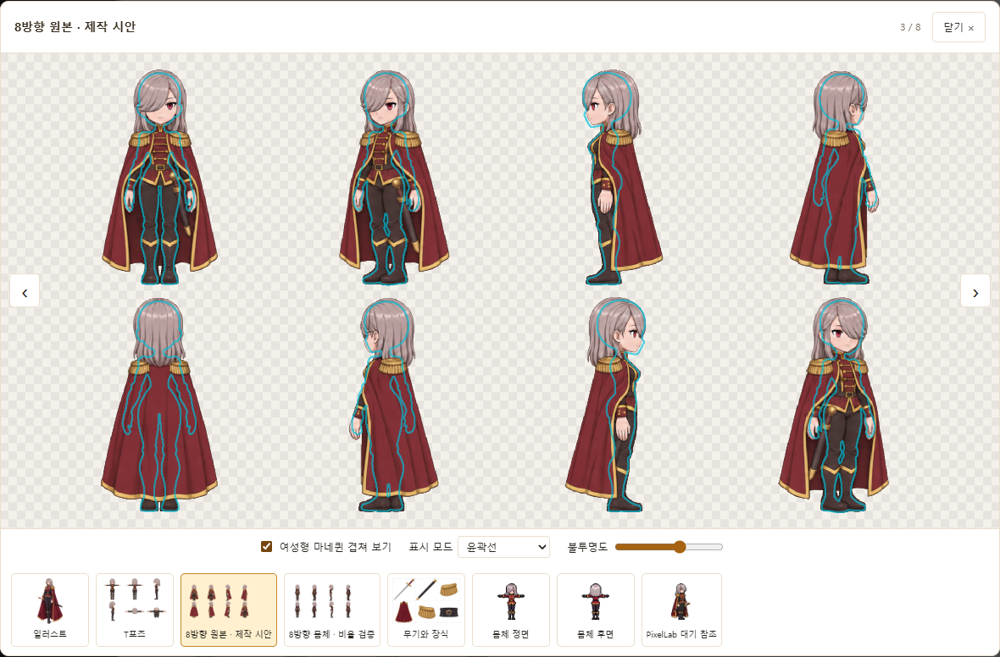

## 작업 결과

## 변경 내용

### 적용 내용

시안 변경 및 가이드 예제 연결. 기존 분리 PNG 보존. 프로젝트 커밋 cb11479b.

## 검증

방향당 512×512 및 3방향 픽셀 반전 확인. 발바닥 높이 차이 0px. 기존 발 높이 그대로, 좌우 발 중심 오차 최대 0.5px. 웹 빌드와 로컬 윤곽 전환 확인.

## 남은 사항

수정 미리보기는 단일 PNG. 분리 망토 레이어에는 이 편집 미적용. 중앙 배포 미확인.

## 작업 시간

- 제안 시간: 3~5분
- 실제로 완료된 시간: 21:21:31 KST 확인 시작. 21:22:58 KST 보고 작성.
- XERJ: 미사용 — ImageGen, PNG 실측, 로컬 브라우저
