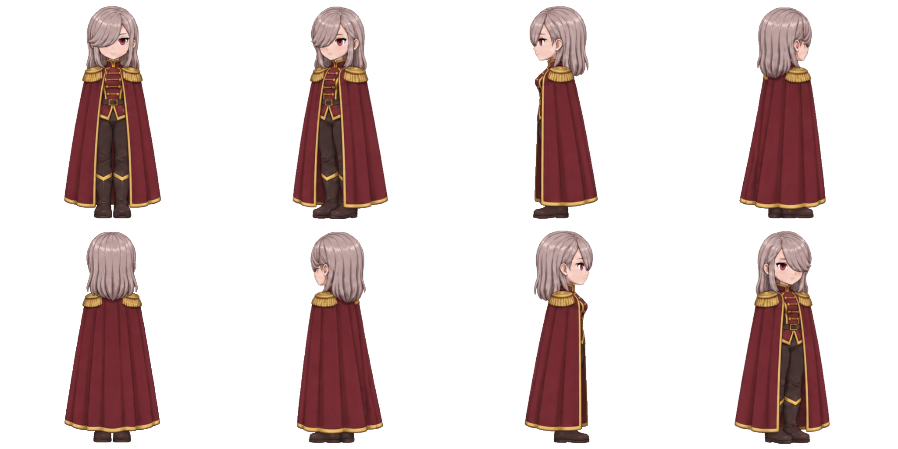
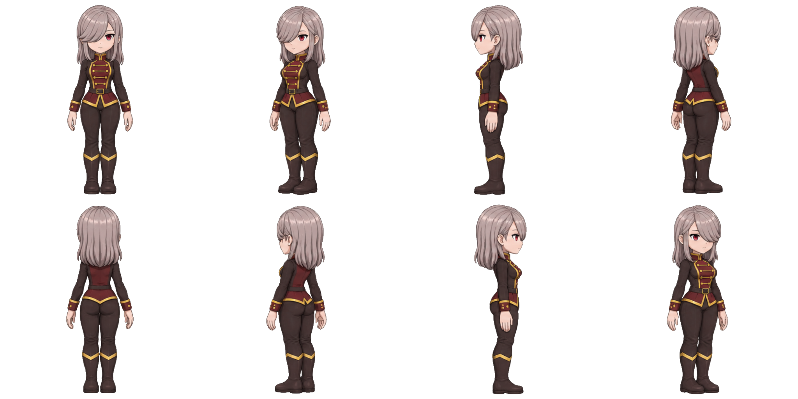
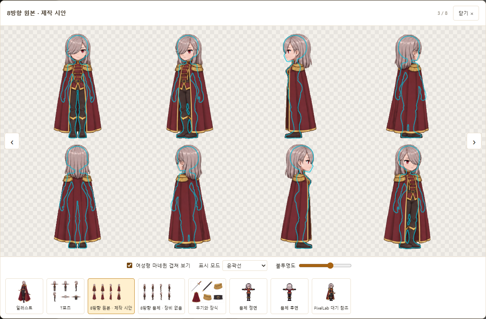

## 작업 결과

## 변경 내용

### 적용 내용

망토 시안 및 장비 없는 몸체 카드 연결. 제작 가이드 갱신. 프로젝트 커밋 898519c5 푸시.

## 검증

방향당 512×512 및 3방향 픽셀 반전 확인. 발바닥 높이 차이 0px. 장비 없는 몸체와 발 위치 일치. 두 카드와 윤곽 모드 표시 확인. 웹 빌드와 로컬 윤곽 전환 확인.

## 남은 사항

수정 미리보기는 단일 PNG. 분리 망토 레이어에는 이 편집 미적용. 중앙 배포 미확인.

## 작업 시간

- 제안 시간: 3~5분
- 실제로 완료된 시간: 21:25:02 KST 확인 시작, 21:25:48 KST 제작·검증·푸시 완료. 46초. 21:26:07 KST 보고 작성.
- XERJ: 미사용 — ImageGen, PNG 실측, 로컬 브라우저
