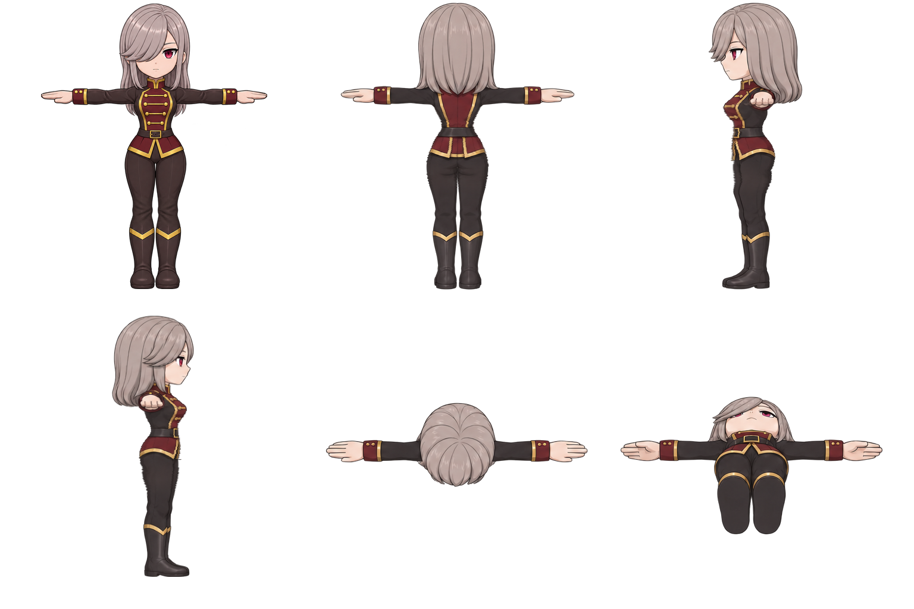
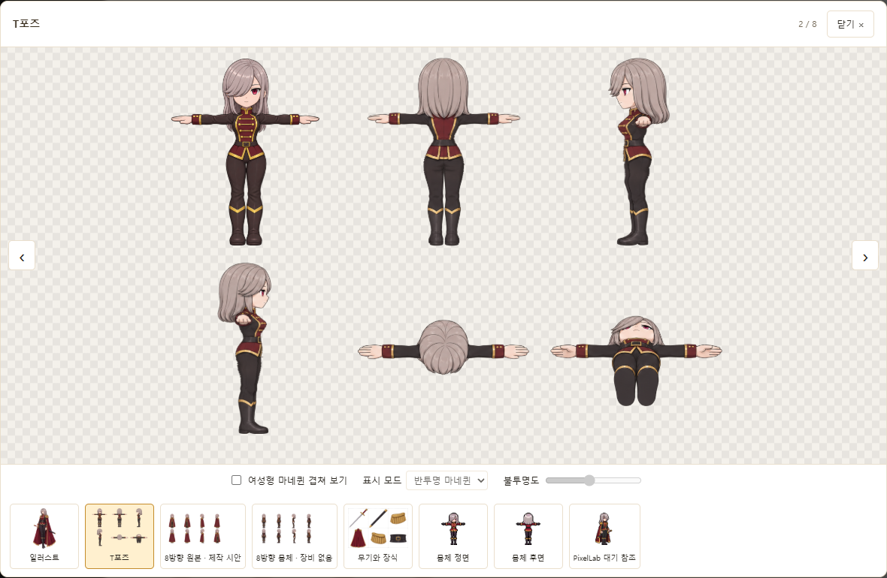
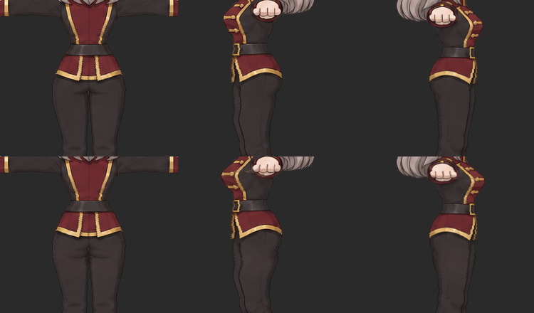

## 작업 결과

## 변경 내용

### 적용 내용

후면 및 좌우 측면의 국소 수정. 아카이브 갱신. 커밋 34e1d455.

## 검증

지정 부위 외 T포즈 픽셀 동일. 웹 빌드 및 모달 표시 확인.

## 남은 사항

중앙 배포 미확인.

## 작업 시간

- 제안 시간: 3~5분
- 실제로 완료된 시간: 21:27:13 KST 확인 시작, 21:29:58 KST 보고 작성.
- XERJ: 미사용 — 실제 PNG와 문서 빌드
