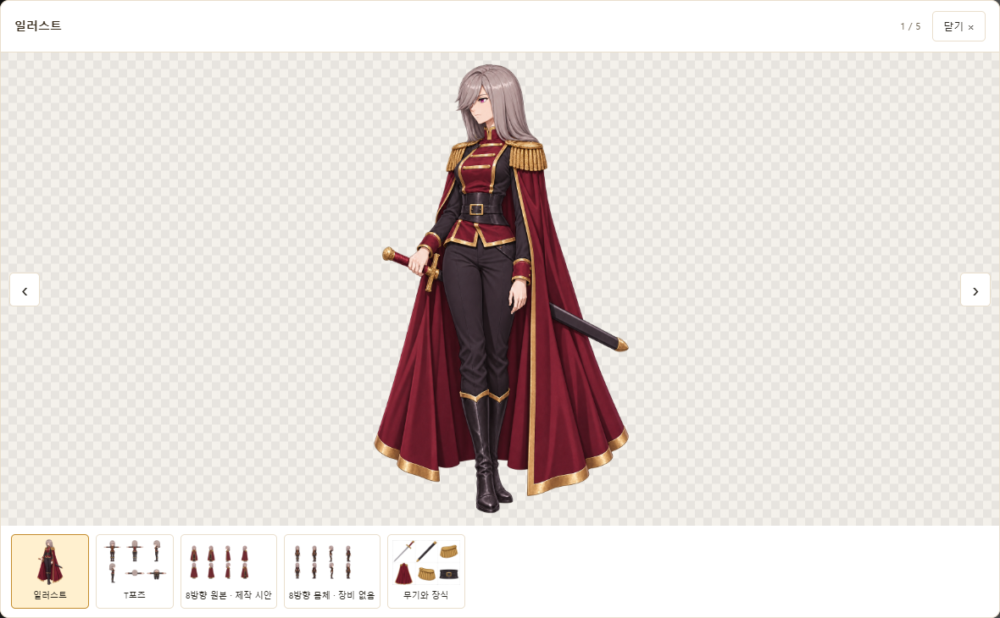

## 작업 결과

## 변경 내용

### 적용 내용

확대 모달 목록을 생성할 때 몸체 정면·후면과 PixelLab 대기 참조를 제외합니다.

## 검증

문서 빌드 성공. 로컬 Chrome에서 붉은 장교 일러스트 확대 후 다섯 이미지와 제외 대상 세 항목을 확인하고 화면을 캡처했습니다.

## 남은 사항

기존 변경이 섞인 생성 HTML은 작업별 커밋 범위에서 제외했습니다. 중앙 배포 및 업데이트 게시판 원격 최신 미확인. 로컬 기록 2026-11-20-014.

## 작업 시간

- 제안 시간: 3~5분
- 실제로 완료된 시간: 21:29:14 KST 시작, 21:31:19 KST 보고서 작성
- XERJ: 미사용 — 로컬 Chrome 실제 모달 화면
