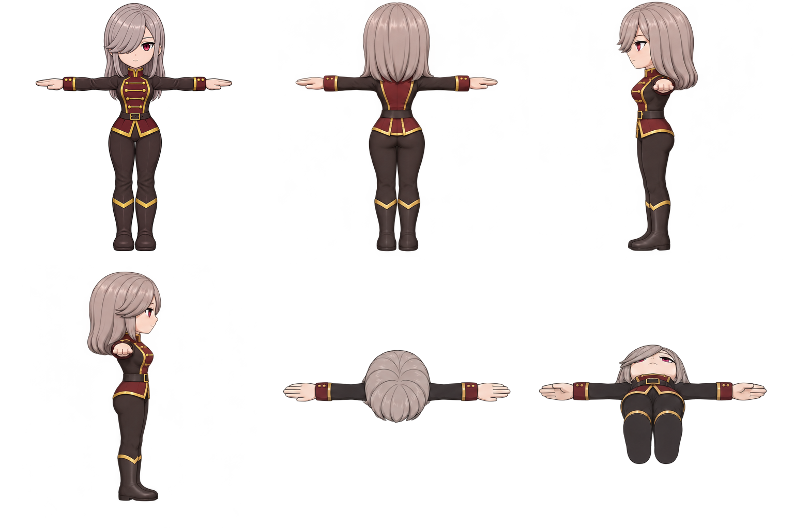
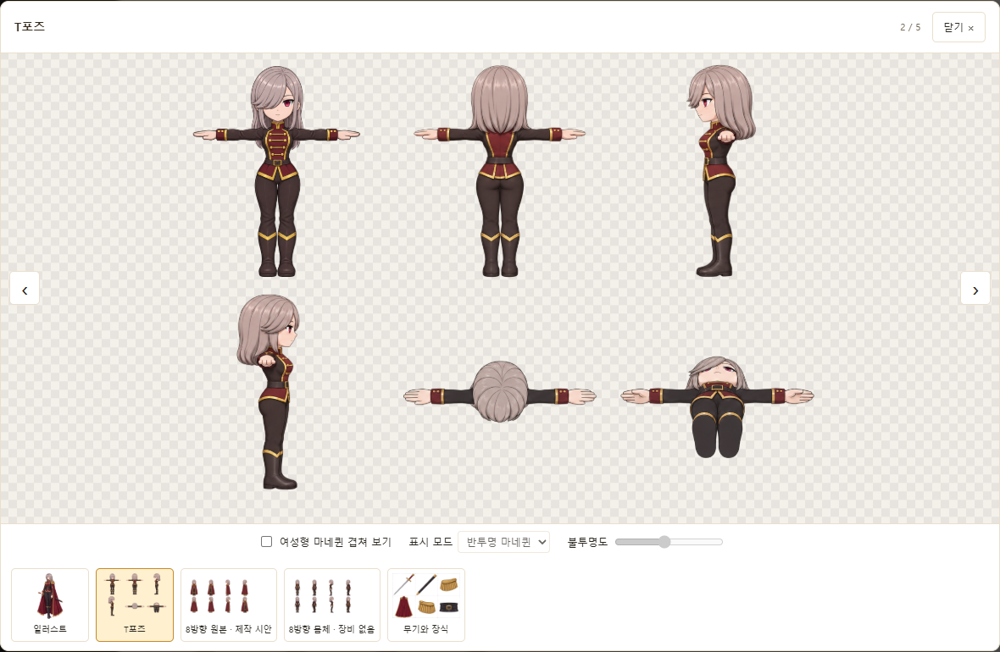

## 작업 결과

## 변경 내용

### 적용 내용

ImageGen 결과의 세 칸 전체 교체. 각 칸은 발 기준으로 평행 이동. 아카이브 갱신. 커밋 1e87e704.

## 검증

정면·윗면·아랫면 픽셀 동일. 웹 빌드 및 모달 표시 확인.

## 남은 사항

중앙 배포 미확인.

## 작업 시간

- 제안 시간: 3~5분
- 실제로 완료된 시간: 21:31:02 KST 확인 시작, 21:32:51 KST 보고 작성.
- XERJ: 미사용 — 실제 PNG와 문서 빌드
