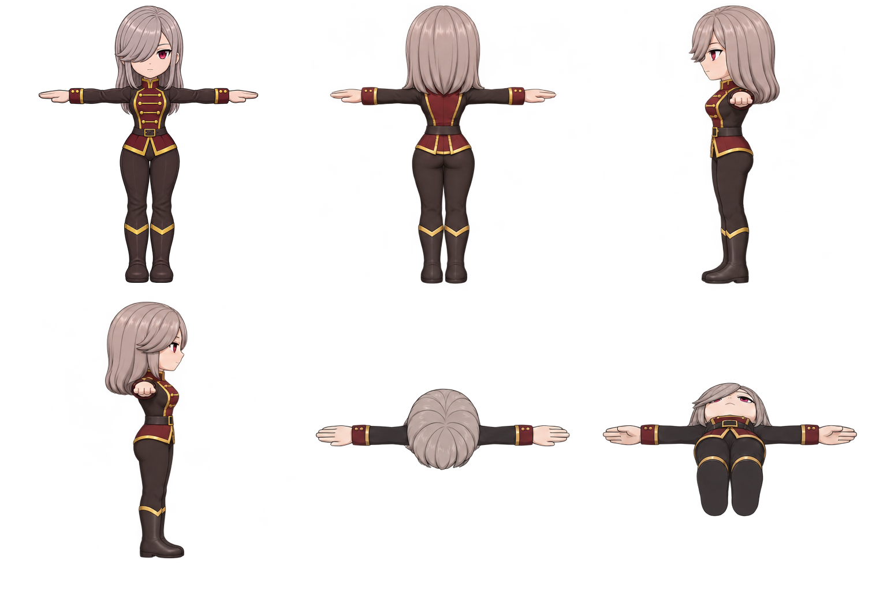
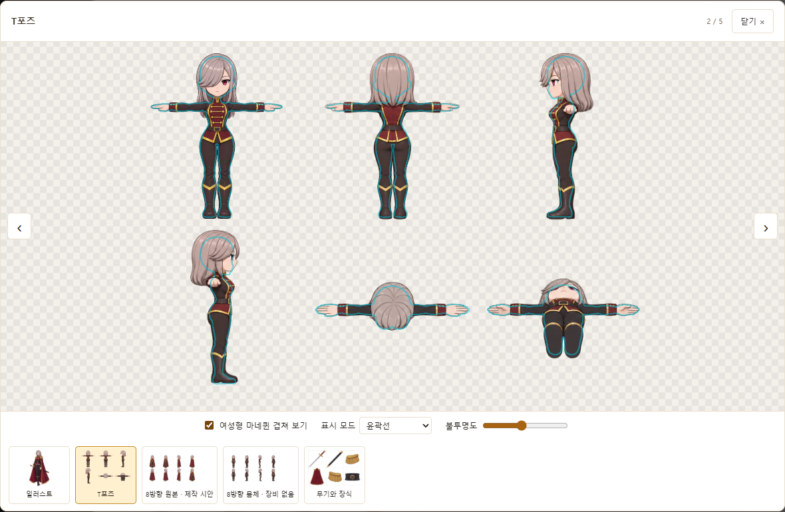

## 작업 결과

## 변경 내용

### 적용 내용

크기와 형태 변환 없이 위치 이동. 칸별 오프셋 기록. 아카이브 갱신. 커밋 1bf22327.

## 검증

정렬 지표 6시점 개선. 실제 아카이브 윤곽선 확인. 웹 빌드 및 모달 표시 확인.

## 남은 사항

중앙 배포 미확인.

## 작업 시간

- 제안 시간: 2~3분
- 실제로 완료된 시간: 21:33:36 KST 확인 시작, 21:34:50 KST 보고 작성.
- XERJ: 미사용 — 실제 PNG와 문서 빌드
