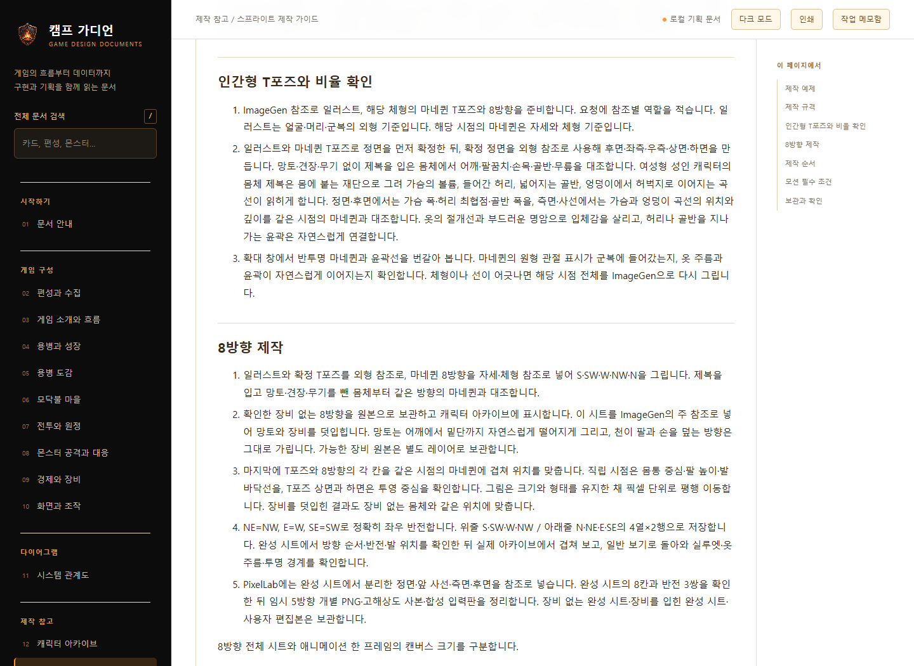

## 작업 결과

## 변경 내용

### 적용 내용

제작 가이드 원문 및 웹 다큐먼트 동기화. 프로젝트 6d9b63a2 푸시.

## 검증

문서 빌드 성공. 실제 브라우저에서 체형 표현 문단, 장비 절차, 픽셀 단위 위치 정렬 표시 확인.

## 남은 사항

중앙 배포 미확인.

## 작업 시간

- 제안 시간: 2~3분
- 실제로 완료된 시간: 21:37:43 KST 시작, 21:39:15 KST 검증 및 푸시 완료. 약 1분 32초.
- XERJ: 미사용 — 가이드 원문, 웹 빌드, 실제 브라우저 캡처
