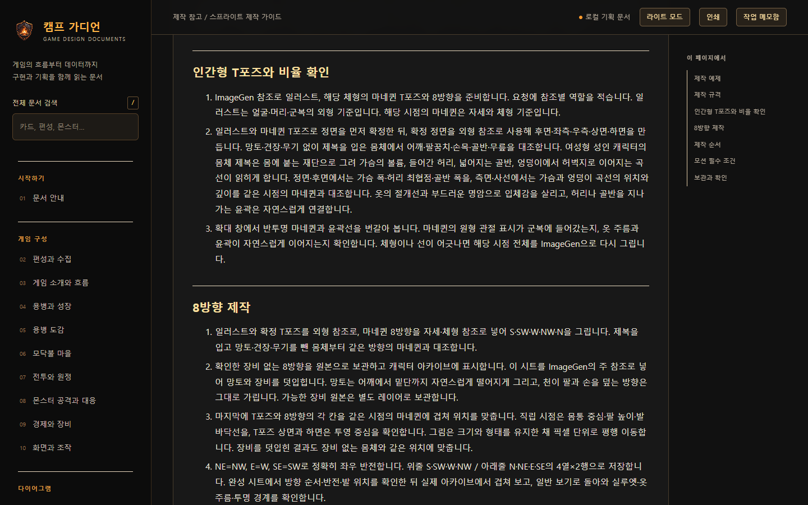

## 작업 결과

## 변경 내용

### 적용 내용

공통 스타일과 생성 페이지 캐시 버전 변경. 프로젝트 0995bdfc 푸시.

## 검증

문서 빌드 성공. 실제 브라우저에서 라이트 및 다크 모드의 목록 글자와 번호 색상 확인.

## 남은 사항

중앙 배포 미확인.

## 작업 시간

- 제안 시간: 2~3분
- 실제로 완료된 시간: 21:40:22 KST 시작, 21:41:09 KST 검증 및 푸시 완료. 약 47초.
- XERJ: 미사용 — 가이드 원문, 웹 빌드, 실제 브라우저 캡처
