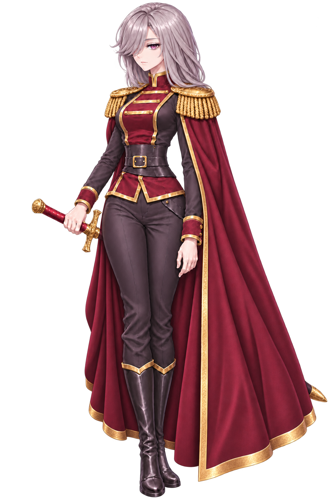
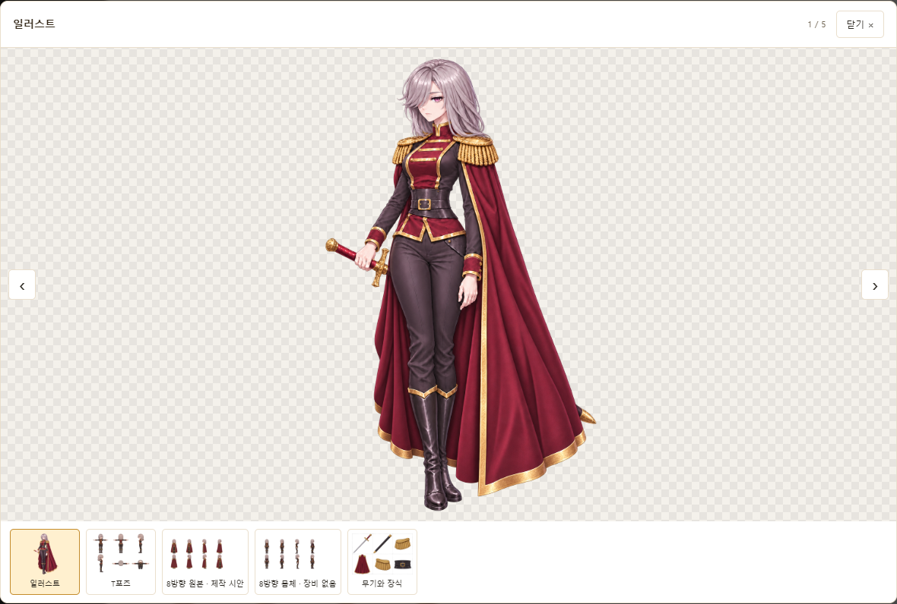

## 작업 결과

## 변경 내용

### 적용 내용

ImageGen 망토 실루엣 수정 및 미리보기 갱신. 아카이브 갱신. 커밋 640bf437.

## 검증

투명 배경과 실제 아카이브 표시 확인. 웹 빌드 및 모달 표시 확인.

## 남은 사항

중앙 배포 미확인.

## 작업 시간

- 제안 시간: 2~4분
- 실제로 완료된 시간: 21:49:45 KST 확인 시작, 21:51:42 KST 보고 작성.
- XERJ: 미사용 — 실제 PNG와 문서 빌드
