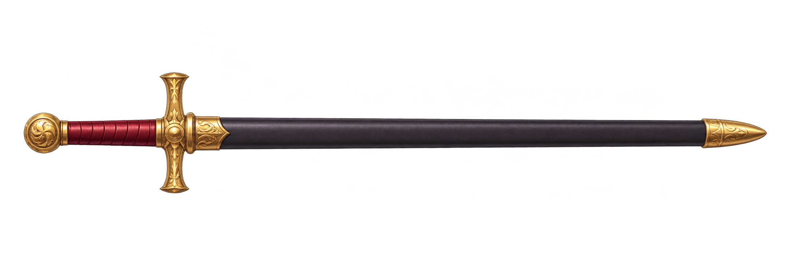

## 작업 결과

## 변경 내용

### 적용 내용

장검 PNG 원본 추가. 9fc79f9d 푸시. 기존 전신 일러스트 보존.

## 검증

2172×724 투명 PNG, 길이 방향 5개 위치 중심 높이 최대 1px 차이. 시각 확인.

## 남은 사항

전신 일러스트에는 별도 시안을 적용하기 전. 중앙 배포 미확인.

## 작업 시간

- 제안 시간: 2~4분
- 실제로 완료된 시간: 21:53:49 KST 확인 시작, 21:54:27 KST 검증 및 푸시 완료. 약 38초.
- XERJ: 미사용 — ImageGen 및 PNG 실측
