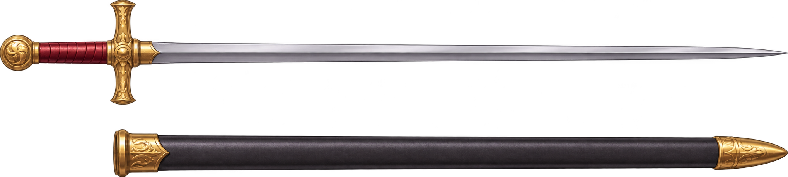
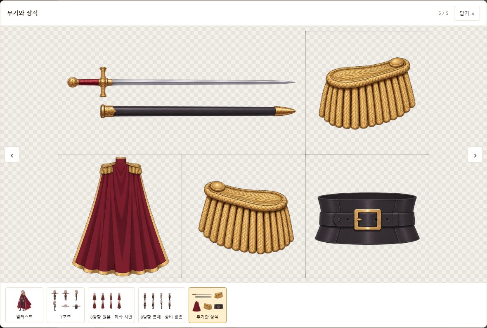

## 작업 결과

## 변경 내용

### 적용 내용

장검·칼집 분리 PNG와 무기·장식 시트 추가. 9982d820 푸시.

## 검증

1536×1024 장식 시트와 분리 PNG 확인. 아카이브 확대창 실제 표시 확인.

## 남은 사항

중앙 배포 미확인.

## 작업 시간

- 제안 시간: 3~5분
- 실제로 완료된 시간: 22:04:40 KST 확인 시작, 22:05:34 KST 검증 및 푸시 완료. 약 54초.
- XERJ: 미사용 — ImageGen 및 PNG 실측
