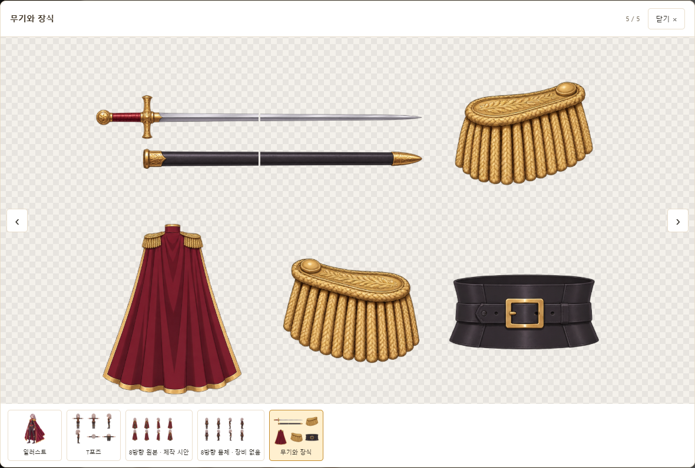

## 작업 결과

## 변경 내용

### 적용 내용

시트 PNG와 다큐먼트 이미지 버전 갱신. 프로젝트 7b19ba92 푸시.

## 검증

문서 빌드 성공. 실제 무기와 장식 확대창 확인.

## 남은 사항

중앙 배포 미확인.

## 작업 시간

- 제안 시간: 1~2분
- 실제로 완료된 시간: 22:06:54 KST 시작, 22:07:25 KST 검증 및 푸시 완료. 약 31초.
- XERJ: 미사용 — 가이드 원문, 웹 빌드, 실제 브라우저 캡처
