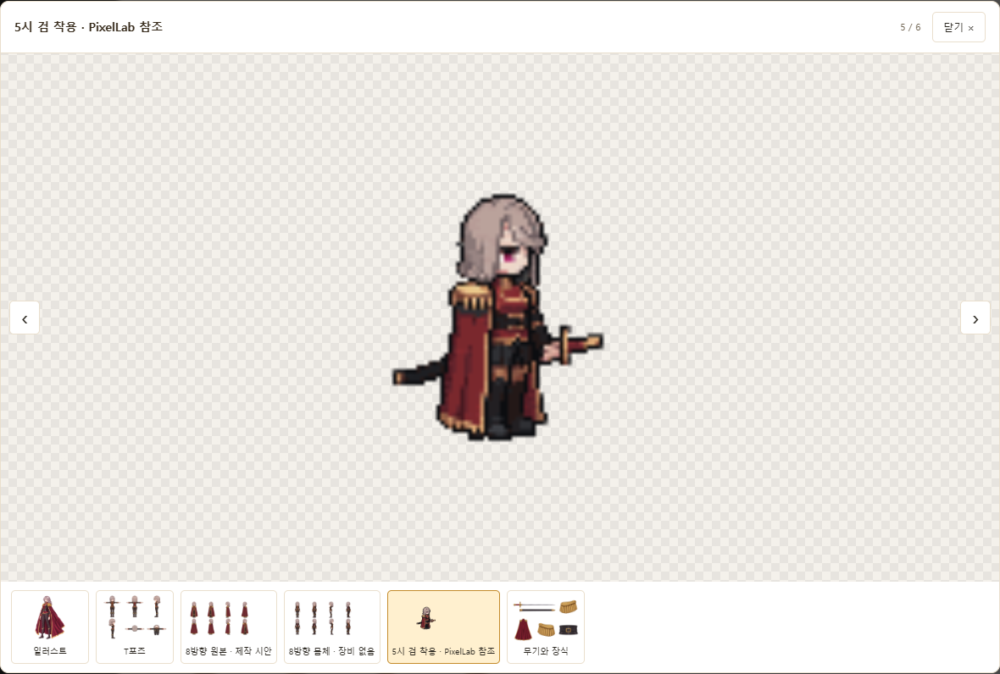

## 작업 결과

## 변경 내용

### 적용 내용

착용 참조 PNG와 아카이브 확대 항목 추가. 프로젝트 bc7c8ae7 푸시.

## 검증

문서 빌드 성공. 아카이브 참조 PNG의 실제 치수 128×128 확인.

## 남은 사항

중앙 배포 미확인.

## 작업 시간

- 제안 시간: 2~4분
- 실제로 완료된 시간: 22:10:52 KST 확인 시작, 22:12:24 KST 검증 및 푸시 완료. 약 1분 32초.
- XERJ: 미사용 — 가이드 원문, 웹 빌드, 실제 브라우저 캡처
