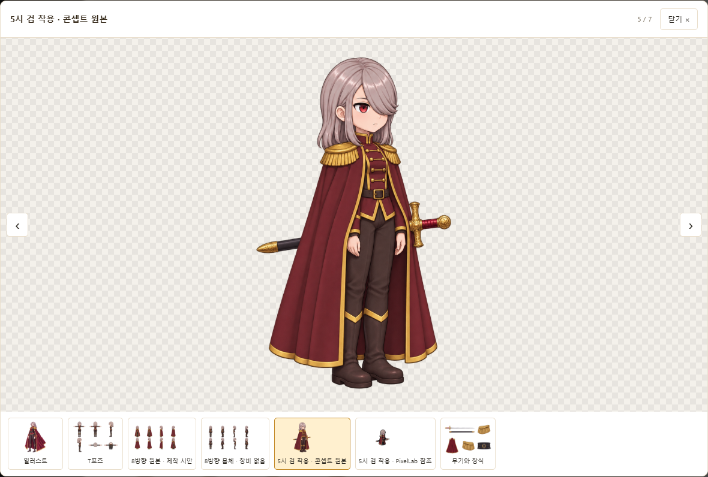

## 작업 결과

## 변경 내용

### 적용 내용

1024×1024 콘셉트 PNG와 아카이브 확대 항목 추가. 프로젝트 df2c971a 푸시.

## 검증

문서 빌드 성공. 아카이브 참조 PNG의 실제 치수 1024×1024 확인.

## 남은 사항

PixelLab 도트 생성은 이번 범위 밖. 중앙 배포 미확인.

## 작업 시간

- 제안 시간: 2~4분
- 실제로 완료된 시간: 22:13:58 KST 확인 시작, 22:15:00 KST 검증 및 푸시 완료. 약 1분 2초.
- XERJ: 미사용 — 가이드 원문, 웹 빌드, 실제 브라우저 캡처
