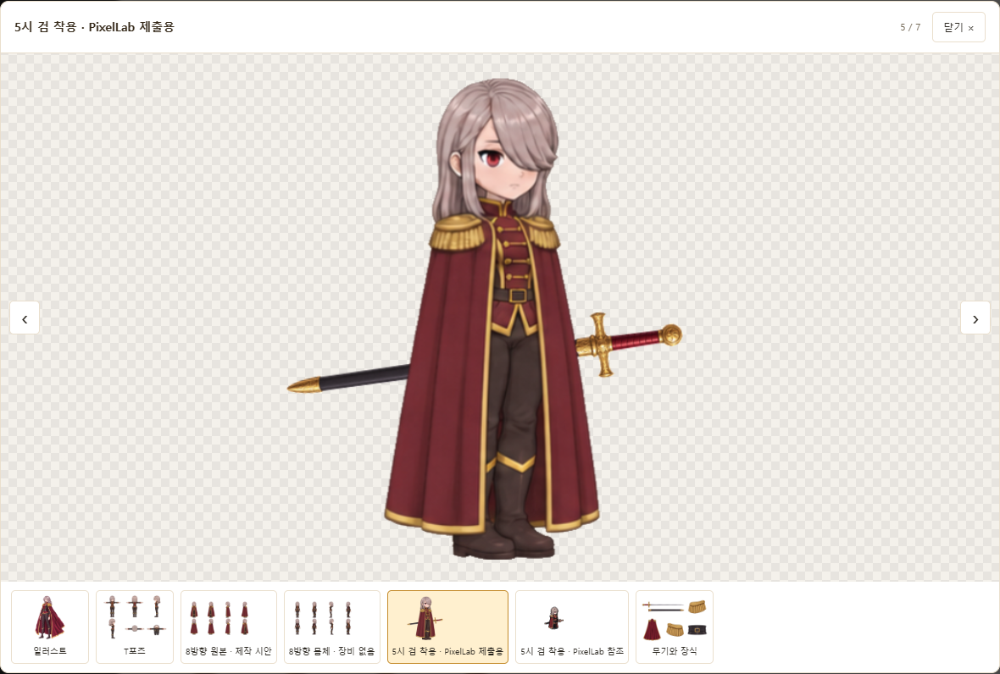
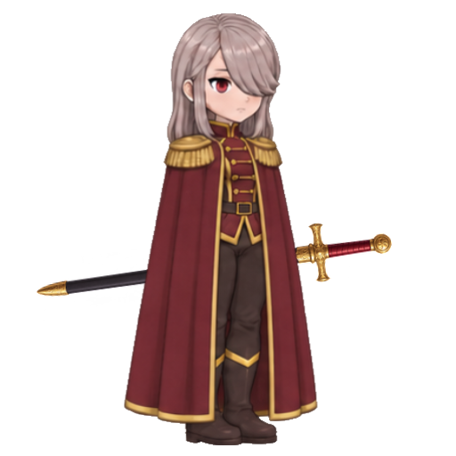

## 작업 결과

## 변경 내용

### 적용 내용

512×512 콘셉트 PNG와 아카이브 확대 항목 추가. 프로젝트 02a34c7c 푸시.

## 검증

문서 빌드 성공. 아카이브 참조 PNG의 실제 치수 512×512 확인.

## 남은 사항

PixelLab 도트 생성은 이번 범위 밖. 중앙 배포 미확인.

## 작업 시간

- 제안 시간: 2~4분
- 실제로 완료된 시간: 22:17:07 KST 확인 시작. 512px 합성 및 가이드 갱신.
- XERJ: 미사용 — 가이드 원문, 웹 빌드, 실제 브라우저 캡처
