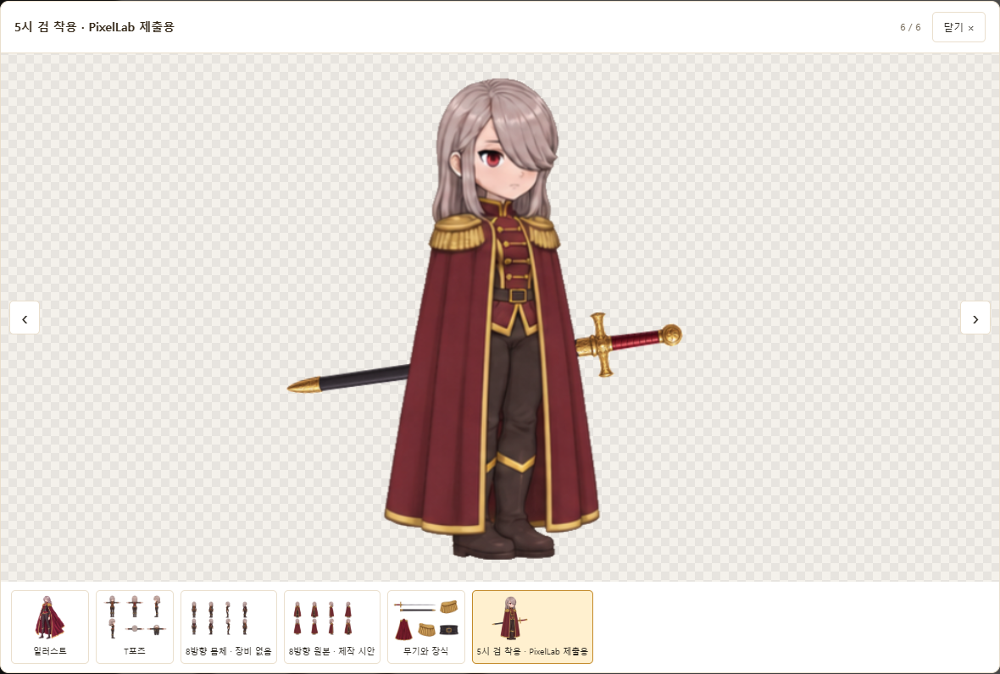

## 작업 결과

## 변경 내용

### 적용 내용

아카이브 참조 목록과 생성 페이지 갱신. 프로젝트 38469c04 푸시.

## 검증

문서 빌드 성공. 실제 모달 6개 항목 순서와 마지막 이미지 확인.

## 남은 사항

중앙 배포 미확인.

## 작업 시간

- 제안 시간: 1~2분
- 실제로 완료된 시간: 22:20:06 KST 확인 시작, 22:20:47 KST 검증 및 푸시 완료. 약 41초.
- XERJ: 미사용 — 가이드 원문, 웹 빌드, 실제 브라우저 캡처
