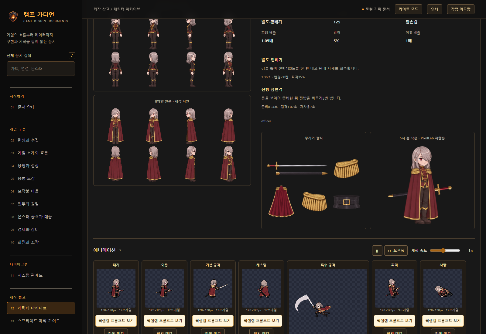

## 작업 결과

## 변경 내용

### 적용 내용

아카이브 상세 이미지 카드와 공통 스타일 반영. 프로젝트 2b3a4a4d 푸시.

## 검증

문서 빌드 성공. 다크 모드에서 이미지 표시와 클릭 시 5번·6번 갤러리 항목 확인.

## 남은 사항

중앙 배포 미확인.

## 작업 시간

- 제안 시간: 2~3분
- 실제로 완료된 시간: 22:22:23 KST 확인 시작, 결과 확인과 푸시 후 보고 작성.
- XERJ: 미사용 — 가이드 원문, 웹 빌드, 실제 브라우저 캡처
