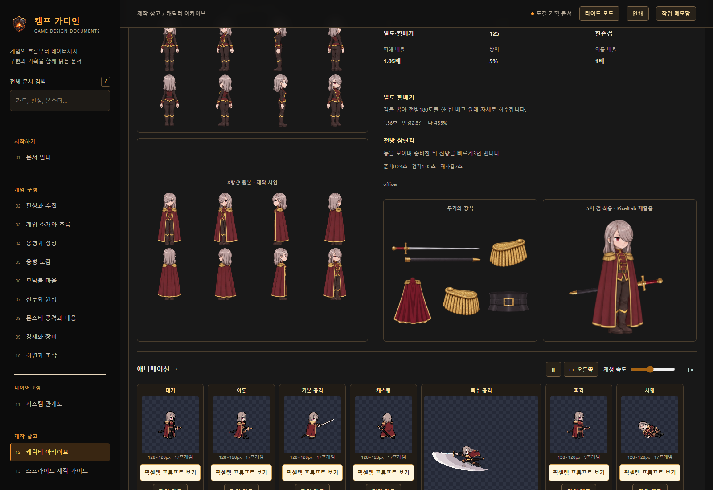
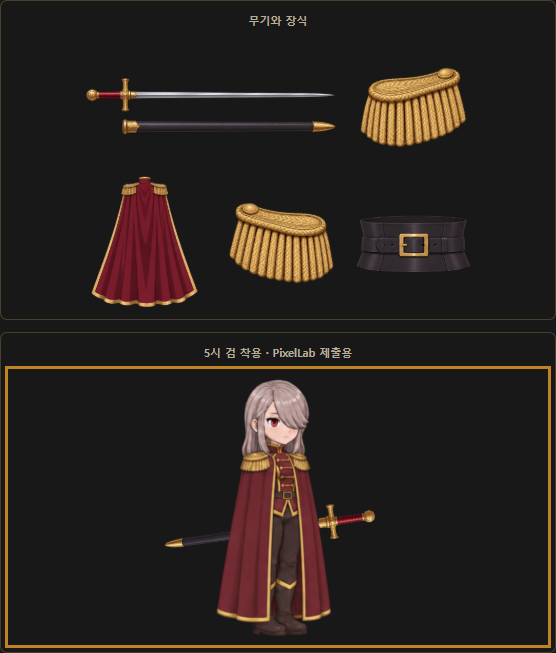

## 작업 결과

## 변경 내용

### 적용 내용

반응형 갤러리 스타일 적용. 프로젝트 1d565470 푸시.

## 검증

문서 빌드 성공. 1600px 창에서 카드 하단 차이 0px, 900px 창에서 두 그룹 한 열 확인.

## 남은 사항

중앙 배포 미확인.

## 작업 시간

- 제안 시간: 1~2분
- 실제로 완료된 시간: 22:24:44 KST 시작, 22:26:27 KST 검증 및 푸시 완료. 약 1분 43초.
- XERJ: 미사용 — 가이드 원문, 웹 빌드, 실제 브라우저 캡처
