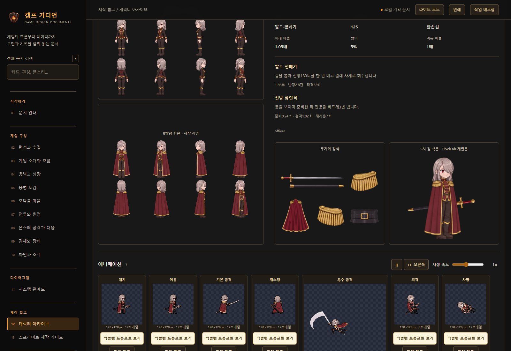
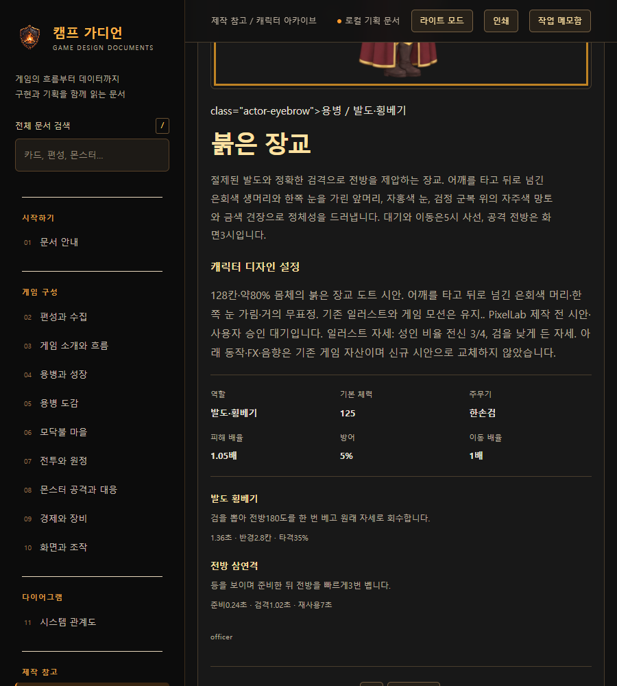

## 작업 결과

## 변경 내용

### 적용 내용

반응형 갤러리 스타일 적용. 프로젝트 ce996db9 푸시.

## 검증

문서 빌드 성공. 900px 창에서 설명이 마지막 이미지 아래에 있는지 확인. 1600px 창의 좌우 하단 차이 0px.

## 남은 사항

중앙 배포 미확인.

## 작업 시간

- 제안 시간: 1~2분
- 실제로 완료된 시간: 22:27:45 KST 시작, 22:28:17 KST 검증 및 푸시 완료. 약 32초.
- XERJ: 미사용 — 가이드 원문, 웹 빌드, 실제 브라우저 캡처
