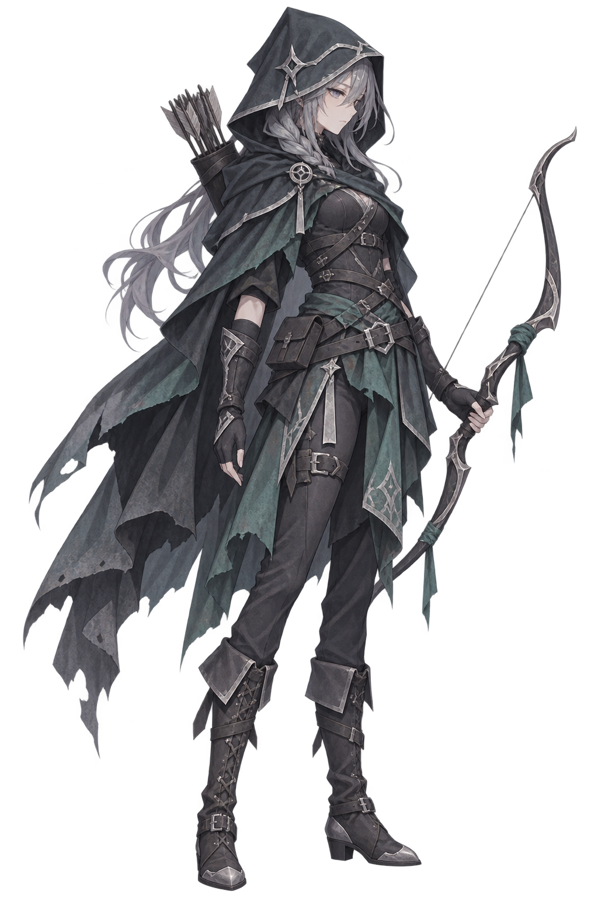
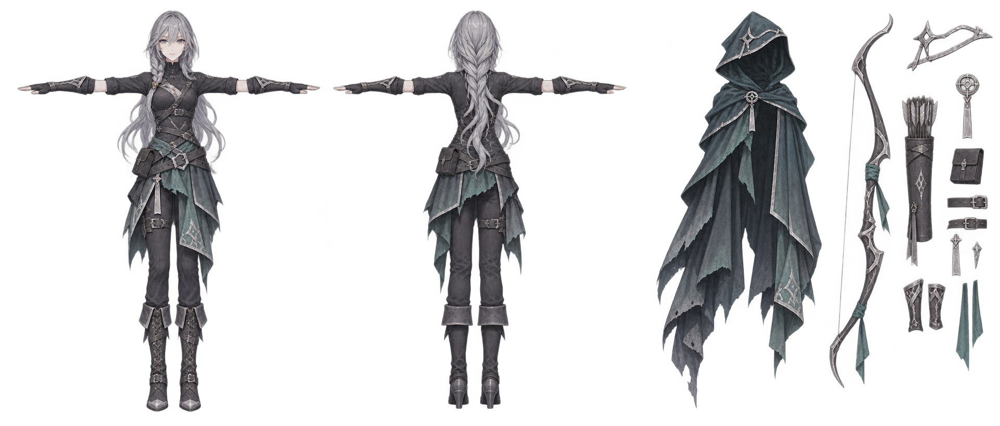
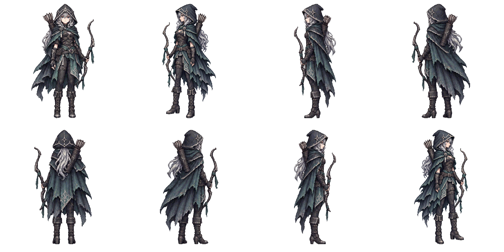

## 작업 결과

PixelLab 전 단계 시안 저장 완료.

## 변경 내용

### 적용 내용

청록 후드와 은발, 활을 공통 외형으로 신규 제작. 원격 main에 096936a9 푸시.

## 검증

전체 2048×1024, 8칸 내용과 좌우 반전 3쌍 픽셀 일치 확인. 문서 빌드 성공. PixelLab 및 인게임 실행 미실행.

## 남은 사항

PixelLab 모션과 인게임 연결, 나머지 캐릭터 재제작. 업데이트 원격 조회 실패, 캐시 2026-11-20-014 참조.

## 작업 시간

- 제안 시간: 첫 범위 조사 5~10분
- 실제로 완료된 시간: 2026-11-20 22:44:30 KST 착수, 22:48 KST 이전 시안 저장 및 문서 빌드 확인. 원격 푸시 별도 완료.
- XERJ: 미사용 — rg와 파일 대조 사용.
