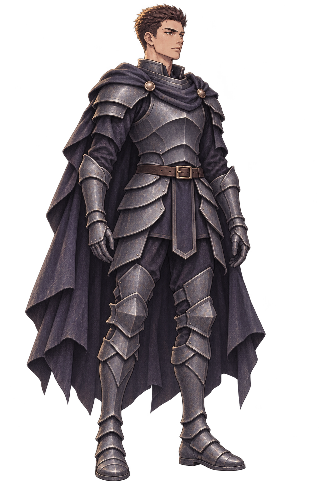
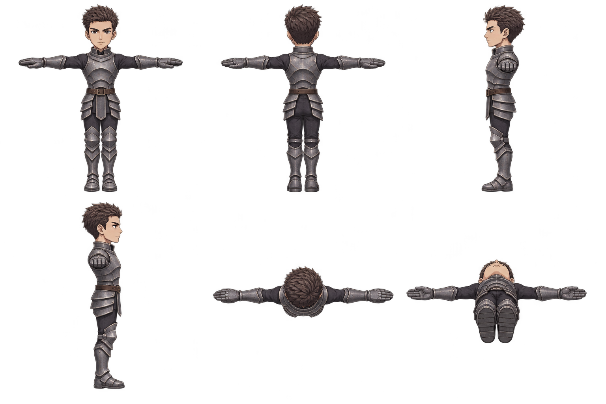
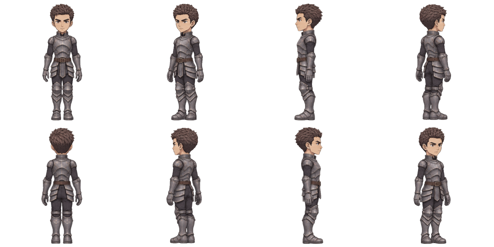
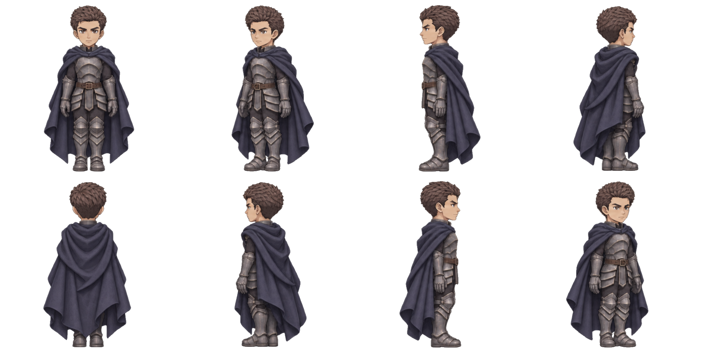
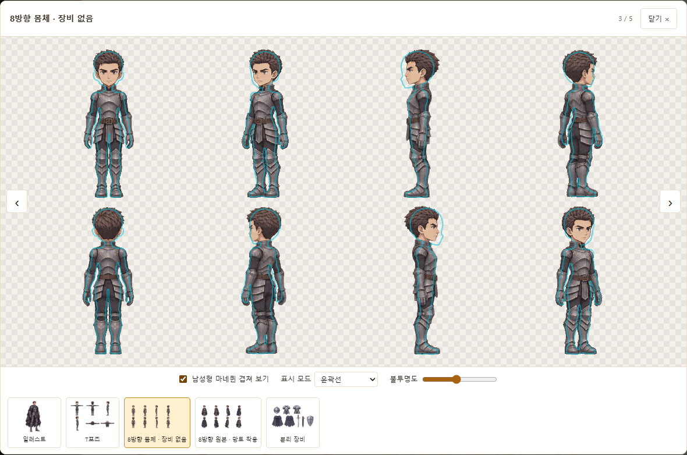

## 작업 결과

## 변경 내용

### 적용 내용

검토 시안과 기존 분리 장비를 아카이브에 연결. 프로젝트 커밋 a49dac60.

## 검증

방향당 512×512 및 3방향 픽셀 반전 확인. 발바닥 높이 차이 0px. 방향별 발 기준 이동과 일률 배율. 아카이브 남성형 윤곽 표시 확인. 웹 빌드와 로컬 윤곽 전환 확인.

## 남은 사항

오른쪽 T포즈는 머리 잘림을 막아 발 맞춤 제한. 검·방패 착용 제출 PNG 미제작. 다른 캐릭터는 별도 진행. 중앙 배포 미확인.

## 작업 시간

- 제안 시간: 5~8분
- 실제로 완료된 시간: 23:02:06 KST 확인 시작. 23:07:26 KST 보고 작성.
- XERJ: 미사용 — ImageGen, PNG 실측, 로컬 브라우저
