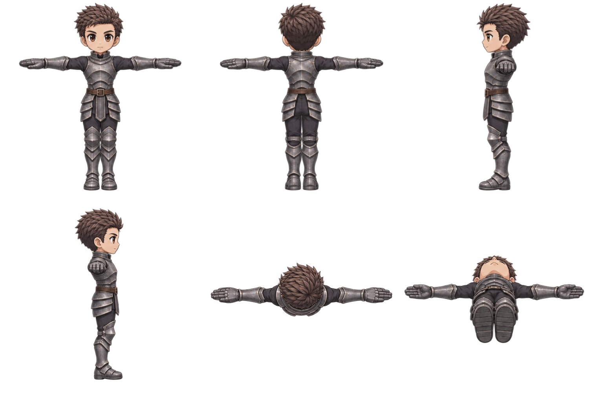
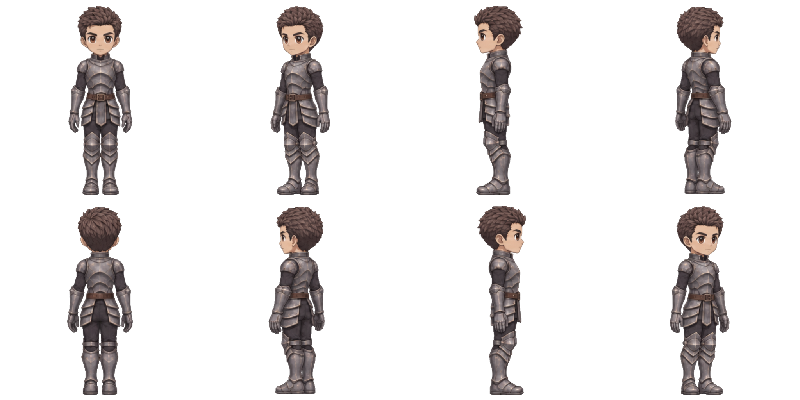
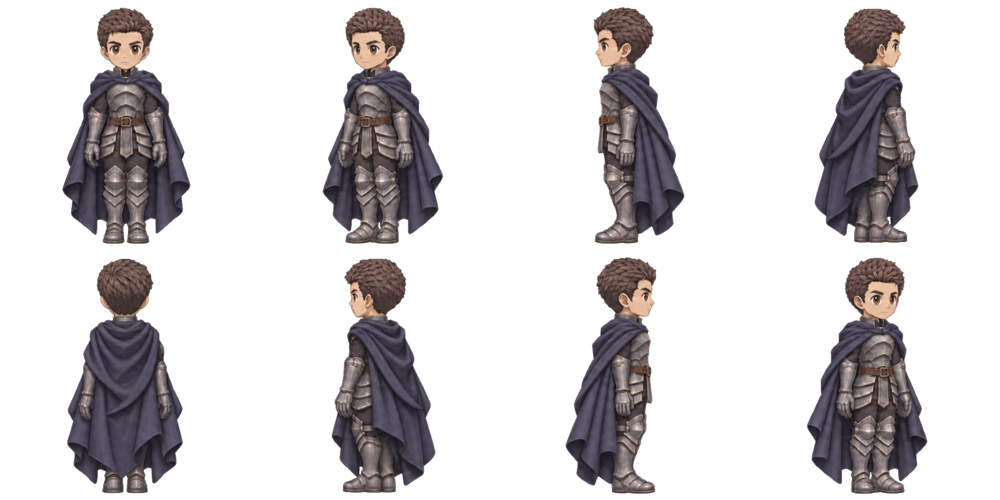
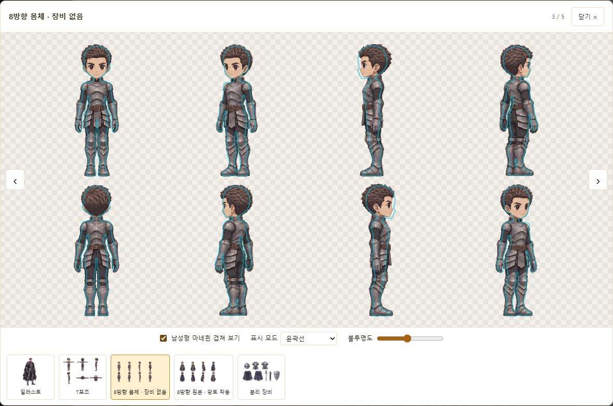
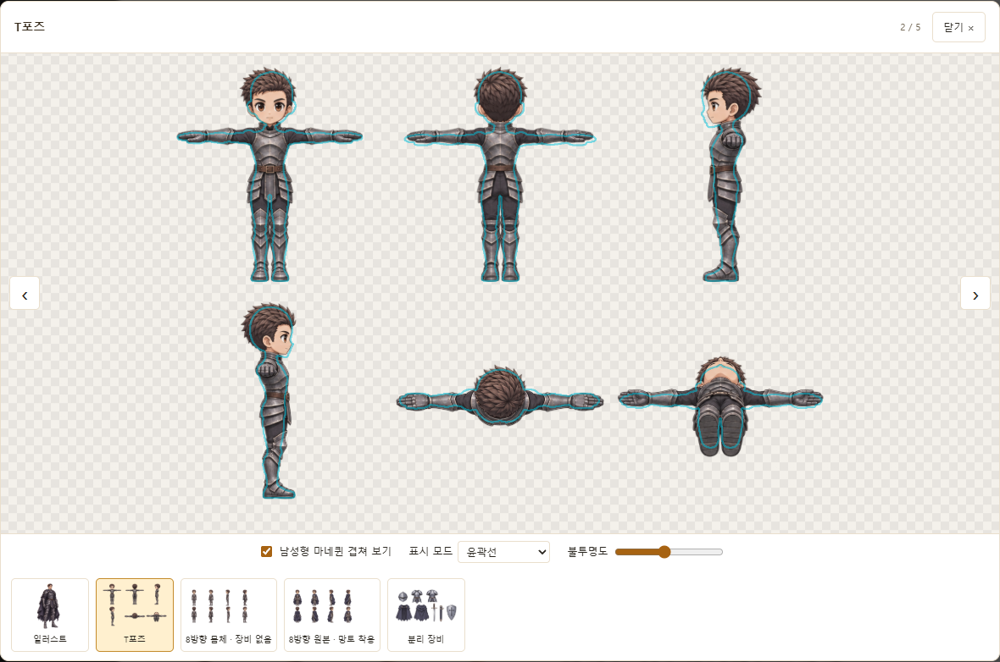

## 작업 결과

## 변경 내용

### 적용 내용

검토 시안과 기존 분리 장비를 아카이브에 연결. 프로젝트 커밋 5b4be840.

## 검증

방향당 512×512 및 3방향 픽셀 반전 확인. 발바닥 높이 차이 0px. 방향별 발 기준 이동과 일률 배율. 아카이브 남성형 윤곽 표시 확인. 웹 빌드와 로컬 윤곽 전환 확인.

## 남은 사항

오른쪽 측면 T포즈는 약 91% 균일 배율로 발 위치 맞춤. 갑옷과 머리카락 윤곽에 차이가 남음. PixelLab 미진행. 중앙 배포 미확인.

## 작업 시간

- 제안 시간: 4~7분
- 실제로 완료된 시간: 23:09:21 KST 확인 시작. 23:12:41 KST 보고 작성.
- XERJ: 미사용 — ImageGen, PNG 실측, 로컬 브라우저
