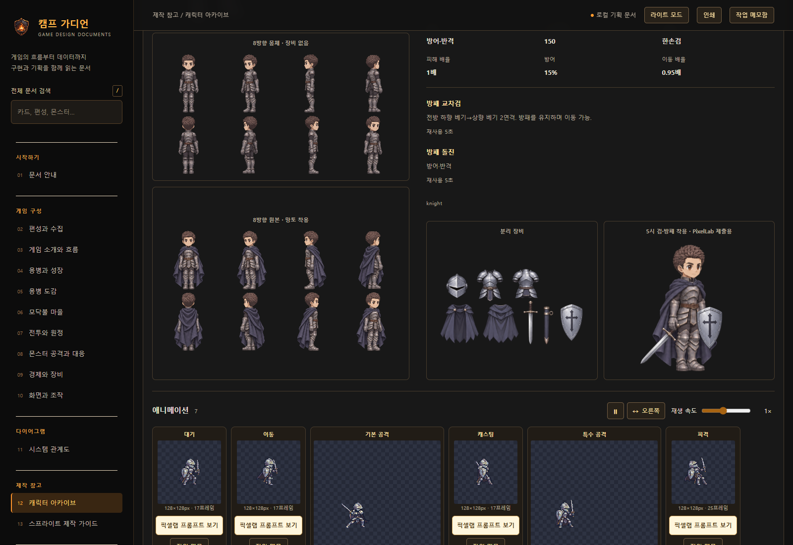

## 작업 결과

## 변경 내용

### 적용 내용

512×512 콘셉트 PNG와 아카이브 확대 항목 추가. 프로젝트 a681506f 푸시.

## 검증

문서 빌드 성공. 아카이브 참조 PNG의 실제 치수 512×512 확인.

## 남은 사항

PixelLab 도트 생성은 이번 범위 밖. 중앙 배포 미확인.

## 작업 시간

- 제안 시간: 3~5분
- 실제로 완료된 시간: 23:18:59 KST 시작, 23:20:05 KST 검증 및 푸시. 1분 6초.
- XERJ: 미사용 — 가이드 원문, 웹 빌드, 실제 브라우저 캡처
